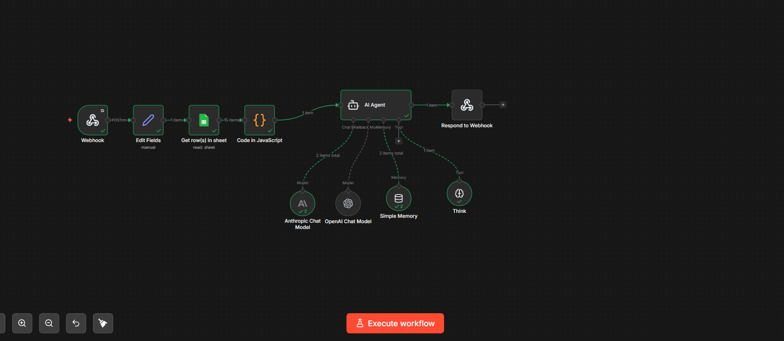
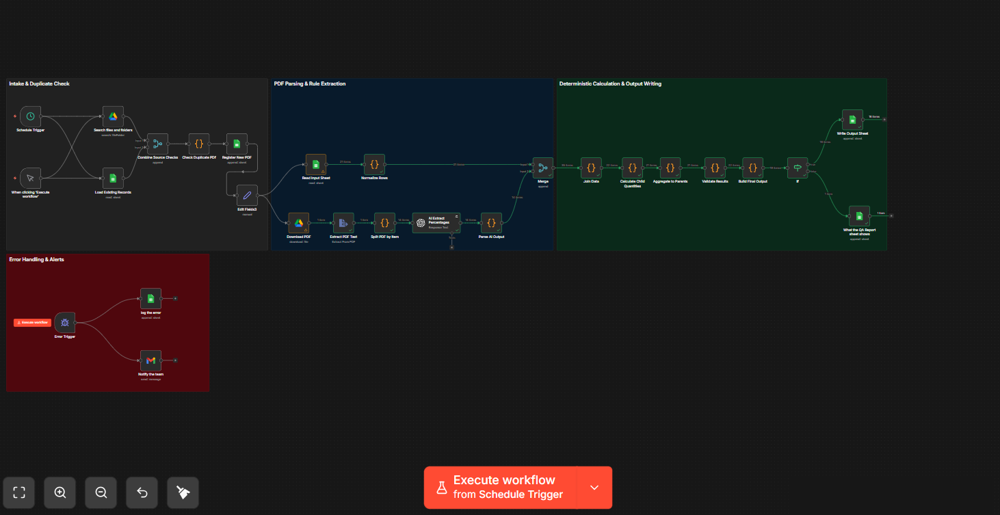
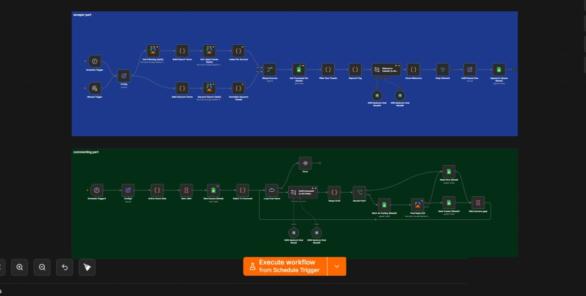

# Khaled Abdelaziz — AI Engineer

**LLM applications · AI agents · enterprise workflow automation**

AI Engineer at **Quara Holding**, the Riyadh-headquartered group behind Saudi-listed **Dar Al Arkan**, London-listed **Dar Global** (US$23 billion development portfolio) and proptech platform **Wasalt**. I design, build and run production AI systems: conversational agents, retrieval-grounded assistants, document intelligence and integration pipelines.

This repository documents **ten AI and automation systems** from my client and employer work before Quara, plus the **shared error handler** every one of them reports to.

[LinkedIn](https://www.linkedin.com/in/khaledabdelaziz-ai) · [Email](mailto:khaledabdelaziz1330@gmail.com)

---

## Current role — AI Engineer, Quara Holding (Jun 2026 – present)

Multinational real estate, finance and technology group operating in **13 countries**. Work here is confidential, so none of it is published in this repository; the scope below matches my CV.

| | |
|---|---|
| **Production systems** | **7+ AI agents and workflows** across Dar Al Arkan, Dar Global and Wasalt, adopted by the sales, marketing and multimedia teams |
| **Prospect intelligence** | Spearheading Dar Global's AI prospect-intelligence engine for international luxury sales — **5,000+ high-net-worth prospects** enriched, verified and AI-scored into the CRM |
| **Conversational AI** | Arabic/English agents that qualify leads and handle customer conversations for a branded-luxury portfolio in **9 countries** |
| **Integration** | CRM, paid media, messaging and internal systems connected for a **1,300+ broker** sales network — **30+ hours of manual work saved per week** |
| **Governance** | Prompt libraries, no-code agent interfaces and dashboards, monitored for accuracy, reliability and cost |

The public systems below show the same engineering approach on work I can share.

---

## Featured systems

### Clinic AI Receptionist
**n8n · OpenAI (gpt-4o, gpt-4o-mini) · Google Calendar · Google Sheets · Meta Graph API · Telegram**

One webhook receives patient messages from four channels and normalizes them into a single schema. A deterministic gpt-4o-mini classifier routes each message; gpt-4o extracts booking details as JSON; **free slots are computed in code from live Google Calendar data** — the model never decides availability. Replies return through the channel the patient used, in Arabic or English.

**Impact (90-day production window):** 90%+ of inquiries handled end to end · replies under 2 minutes · front-desk workload down 70% (35–40 → 10–12 h/week) · no-shows 18% → 6%.

[README](./clinic-booking-system) · [Architecture](./clinic-booking-system/architecture.md) · [Performance](./clinic-booking-system/PERFORMANCE.md) · [Setup guide](./clinic-booking-system/setup.md)

### Hostzera — Retrieval-Grounded Chat Assistant
**n8n · Anthropic Claude · Google Sheets · JavaScript**

Every visitor message is scored against a staff-editable knowledge base; only the top five rows reach Claude, which is instructed to answer from that context alone and hand off when it cannot. Knowledge-base retrieval and session history load in parallel and merge before a single model call.

**Impact:** ~0.5% hallucination rate measured on a 200-conversation audit · support tickets 35% → 12% · 1.5 s typical response · ~$0.018 per conversation.

[README](./hostzera-chat-widget) · [Architecture](./hostzera-chat-widget/architecture.md) · [Performance](./hostzera-chat-widget/PERFORMANCE.md)

### Document Automation — PDF to Excel
**n8n · OpenAI (gpt-4o) · JavaScript · Gmail · Google Sheets**

Specification PDFs arrive by email. The LLM extracts handling instructions ("reuse 40%, dispose 30%") as structured rules, exactly as written. **Every calculation, aggregation and validation runs in deterministic code**, and a QA gate routes low-confidence runs to human review instead of delivering them.

**Core principle:** AI for language, code for math — LLM arithmetic errors are avoided because every calculation is deterministic.

[README](./document-automation-system) · [Architecture](./document-automation-system/architecture.md) · [Performance](./document-automation-system/PERFORMANCE.md)

### Autonomous X & Instagram Engagement Agents
**n8n · AWS Bedrock · Apify · Unipile · Google Sheets**

Two agents built for a climate-tech brand. Each runs a scraper pipeline and a commenter pipeline linked by a Sheets queue: candidates pass cheap pre-filters, then an LLM relevance classifier with fail-closed JSON parsing, then hard caps, active-hours gating, randomized pacing and duplicate locks before anything is posted.

[X agent](./x-engagement-system) · [Instagram agent](./instagram-engagement-system)

---

## All systems

| System | What it does | Headline result | Status |
|---|---|---|---|
| [Clinic AI Receptionist](./clinic-booking-system) | Books patients across WhatsApp, Instagram, Messenger, Telegram | **90%+** of inquiries handled end to end · **70%** less front-desk work · no-shows **18% → 6%** | Production |
| [Hostzera Chat Assistant](./hostzera-chat-widget) | Retrieval-grounded sales & support assistant (Claude) | **~0.5%** hallucination rate on a 200-conversation audit · support tickets **35% → 12%** | Production since Jan 2026 |
| [Document Automation](./document-automation-system) | Construction spec PDFs → structured Excel | **Zero LLM arithmetic** — code does every calculation · **15–30 s** per PDF | Built for construction document processing |
| [Lead Generation & Outreach](./lead-generation-system) | Scrape → dedupe → verify → AI draft → human approval | **<2%** bounce rate · **8–12%** reply rate | Marketing-agency campaigns |
| [X Engagement Agent](./x-engagement-system) | Finds relevant posts, LLM-vets them, posts expert replies | Replaces **~1–2 h/day** of skilled work · up to **24** replies/day | Ran unattended in production |
| [Instagram Engagement Agent](./instagram-engagement-system) | Off-account discovery, LLM filtering, managed-API commenting | Full lifecycle with **zero manual steps** · self-healing queue | Production |
| [Gym Lead Management](./gym-lead-management) | Multi-channel lead capture → trial booking → membership | **1,450** inbound messages → **522** trials → **137** members in 90 days | Production (single location) |
| [Beauty Center Reception](./beauty-center-reception-workflow) | Service matching and specialist booking | **86%** first-message service match · **zero** double bookings | Production |
| [Wellness Club (GHL + n8n)](./holistic-wellness-club) | GoHighLevel client journey + n8n event log | Bookings, reminders and nurture automated end to end | Built & tested in staging |
| [Marketing Content Pipeline](./marketing-lead-engine) | RSS → AI rewrite → author permission request | Credited, permission-first LinkedIn drafts with an audit log | Working build |
| [Shared Error Handler](./shared-error-handler) | Sanitized logging and alerting for every workflow | Secrets and PII redacted before any log or alert | Used by all workflows |

---

## Career & where each system comes from

| Period | Role | Systems in this repository |
|---|---|---|
| Jun 2026 – present | **AI Engineer, Quara Holding** | Confidential (see *Current role*) |
| Jan – Jun 2026 | **AI Automation Engineer, Hostzera** (web hosting, Netherlands) | [Hostzera Chat Assistant](./hostzera-chat-widget) · automation that cut manual data entry by **80%** across HubSpot, Airtable and GoHighLevel |
| Jul – Dec 2025 | **AI Automation Engineer, OMB** (marketing agency, Netherlands) | [Lead Generation & Outreach](./lead-generation-system) · lead systems processing **150+ leads/month** · AI content workflow that cut production time by **70%** |
| Jan – Jun 2025 | **Independent — healthcare, fitness & beauty clients** | [Clinic AI Receptionist](./clinic-booking-system) · [Gym Lead Management](./gym-lead-management) · [Beauty Center Reception](./beauty-center-reception-workflow) · [Wellness Club](./holistic-wellness-club) |
| Client & independent builds | Construction, climate-tech and content | [Document Automation](./document-automation-system) · [X Agent](./x-engagement-system) · [Instagram Agent](./instagram-engagement-system) · [Marketing Content Pipeline](./marketing-lead-engine) |

---

## Engineering standards

The same engineering bar applies to every system. Details in [`PATTERNS.md`](./PATTERNS.md) and [`SECURITY.md`](./SECURITY.md).

| Standard | How it is implemented |
|---|---|
| **AI for language, code for math** | LLMs classify, extract and write; availability, prices, quantities and dedup are computed in code |
| **Resilience** | External reads and AI calls retry 3× (2 s apart); outbound sends and bookings are never auto-retried, so a retry can't double-message or double-book |
| **Observability** | Every workflow reports to the [shared error handler](./shared-error-handler): sanitized log row for every failure, Slack alert for high-severity ones |
| **Human-in-the-loop** | Mandatory approval gates on outbound email and low-confidence document output |
| **Idempotency** | Event IDs and lock states prevent duplicate rows, replies and posts under webhook retries |
| **Data protection** | Secrets and PII redacted from logs; data minimisation in prompts; design aligned with Saudi PDPL and GDPR principles |

---

## Repository structure

Each project folder contains:

- **`README.md`** — what the system does, impact, stack, scope of the export
- **`architecture.md`** — Mermaid diagrams, design decisions, data model, failure modes
- **`PERFORMANCE.md`** — production metrics, cost, reliability and scale limits
- **`code_examples.md`** — code taken from the workflow's nodes
- **`workflow.json`** — sanitized n8n export (importable after replacing placeholder credentials)

The X and Instagram agents ship with a README and workflow diagram; their exports are available on request. Where a screenshot shows the original build and differs from `workflow.json`, the README says so — the JSON is the reference implementation.

---

## Tech stack

| Category | Tools |
|---|---|
| **AI & LLMs** | Anthropic Claude, OpenAI (gpt-4o, gpt-4o-mini), AWS Bedrock, Google Gemini · retrieval-augmented generation · structured-output prompting |
| **Orchestration** | n8n (self-hosted on Docker), GoHighLevel, Make, Zapier |
| **Data & enrichment** | Apify, Clay, LinkedIn Sales Navigator, ZeroBounce |
| **CRM & storage** | HubSpot, Airtable, Zoho, Google Sheets, Google Calendar |
| **Channels** | WhatsApp Business API, Messenger, Instagram (Unipile), Telegram Bot API, Gmail, Slack |
| **Engineering** | JavaScript (n8n Code nodes) · Python & SQL (working knowledge) · Git/GitHub · Docker · VPS · Claude Code, Cursor |

---

## Notes

- All `workflow.json` files are **sanitized templates**: credentials are `REPLACE_*` placeholders and configuration comes from `$env.*` variables. No client data, keys or production URLs are included — see [`SECURITY.md`](./SECURITY.md).
- Metrics come from each system's `PERFORMANCE.md`, which states the measurement window and method.
- Happy to walk through any system in a technical review — [get in touch](mailto:khaledabdelaziz1330@gmail.com).
