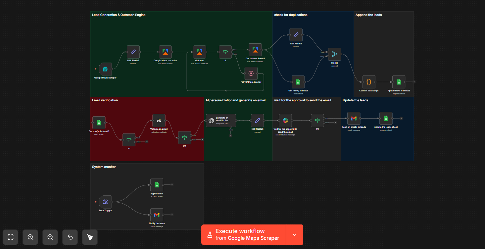
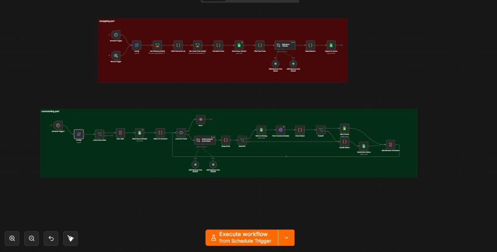

# Khaled Abdelaziz — AI Engineer

**LLM applications · AI agents · enterprise workflow automation**

[](https://github.com/khaledabdelaziz1330-dot/Khaled-AI-Automation-Portfolio/actions/workflows/tests.yml)

AI Engineer at **Quara Holding**, the Riyadh-headquartered group behind Saudi-listed **Dar Al Arkan**, London-listed **Dar Global** (US$23 billion development portfolio) and proptech platform **Wasalt**. I design, build and run production AI systems: conversational agents, retrieval-grounded assistants, document intelligence and integration pipelines.

This repository documents **ten AI and automation systems** from my client and employer work before Quara, the **shared error handler** they all report to, and an **automated test suite** that checks the engineering claims below on every push.

[LinkedIn](https://www.linkedin.com/in/khaledabdelaziz-ai) · [Email](mailto:khaledabdelaziz1330@gmail.com)

---

## Current role — AI Engineer, Quara Holding (Jun 2026 – present)

Multinational real estate, finance and technology group operating in **13 countries**. Work here is confidential, so none of it is published in this repository; the scope below matches my CV.

| | |
|---|---|
| **Production systems** | **7+ AI agents and workflows** across Dar Al Arkan, Dar Global and Wasalt, adopted by the sales, marketing and multimedia teams |
| **Prospect intelligence** | Spearheading Dar Global's AI prospect-intelligence engine for international luxury sales — **5,000+ high-net-worth prospects** enriched, verified and AI-scored into the CRM |
| **Conversational AI** | Arabic/English agents that qualify leads and handle customer conversations for a branded-luxury portfolio in **9 countries** |
| **Integration** | CRM, paid media, messaging and internal systems connected for a **1,300+ broker** sales network — **30+ hours of manual work saved per week** |
| **Governance** | Prompt libraries, no-code agent interfaces and dashboards, monitored for accuracy, reliability and cost |

The public systems below show the same engineering approach on work I can share.

---

## Featured systems

### Clinic AI Receptionist
**n8n · OpenAI (gpt-4o, gpt-4o-mini) · Google Calendar · Google Sheets · Meta Graph API · Telegram**


One webhook receives patient messages from four channels and normalizes them into a single schema. A deterministic gpt-4o-mini classifier routes each message; gpt-4o extracts booking details as JSON; **free slots are computed in code from live Google Calendar data, in the clinic's time zone** — the model never decides availability. Replies return through the channel the patient used, in Arabic or English.

**Impact (90-day production window):** 90%+ of inquiries handled end to end · replies under 2 minutes · front-desk workload down 70% (35–40 → 10–12 h/week) · no-shows 18% → 6%.

[README](./clinic-booking-system) · [Architecture](./clinic-booking-system/architecture.md) · [Performance](./clinic-booking-system/PERFORMANCE.md) · [Setup guide](./clinic-booking-system/setup.md) · [Tests](./tests/clinic.test.js)

### Hostzera — Retrieval-Grounded Chat Assistant
**n8n · Anthropic Claude · Google Sheets · JavaScript**


Every visitor message is scored against a staff-editable knowledge base; only the top five rows reach Claude, which is instructed to answer from that context alone and hand off when it cannot. Knowledge-base retrieval and session history load in parallel and merge before a single model call.

**Impact:** ~0.5% hallucination rate measured on a 200-conversation audit · support tickets 35% → 12% · 1.5 s typical response · ~$0.018 per conversation.

[README](./hostzera-chat-widget) · [Architecture](./hostzera-chat-widget/architecture.md) · [Performance](./hostzera-chat-widget/PERFORMANCE.md) · [Tests](./tests/hostzera.test.js)

### Document Automation — PDF to Excel
**n8n · OpenAI (gpt-4o) · JavaScript · Gmail · Google Sheets**


Specification PDFs arrive by email. The LLM extracts handling instructions ("reuse 40%, dispose 30%") as structured rules, exactly as written. **Every calculation, aggregation and validation runs in deterministic code**, and a QA gate routes any run with warnings to human review instead of delivering it.

**Core principle:** AI for language, code for math — LLM arithmetic errors are avoided because every calculation is deterministic and covered by tests.

[README](./document-automation-system) · [Architecture](./document-automation-system/architecture.md) · [Performance](./document-automation-system/PERFORMANCE.md) · [Tests](./tests/document-automation.test.js)

### Lead Generation & Outreach Engine
**n8n · Apify · ZeroBounce · OpenAI (gpt-4o) · Google Sheets · Telegram**



Runs weekly per campaign. Businesses are collected from Google Maps, normalized and **deduplicated by email, phone and domain** against every lead already in the database; addresses are verified with ZeroBounce; gpt-4o drafts a personalized message; **nothing goes out until an operator approves it in Telegram**.

**Impact:** <2% bounce rate · 8–12% reply rate · ~150 verified, approved leads per week per campaign · ~$0.04–0.08 per lead.

[README](./lead-generation-system) · [Architecture](./lead-generation-system/architecture.md) · [Performance](./lead-generation-system/PERFORMANCE.md) · [Tests](./tests/lead-generation.test.js)

---

## Engineering standards

The same engineering bar applies to every system, and it is **checked automatically on every push**. Details in [`PATTERNS.md`](./PATTERNS.md), [`SECURITY.md`](./SECURITY.md) and [`tests/`](./tests).

| Standard | How it is implemented |
|---|---|
| **AI for language, code for math** | LLMs classify, extract and write; availability, quantities and dedup are computed in code |
| **Resilience** | External reads and AI calls retry 3× (2 s apart); outbound sends and bookings are never auto-retried, so a retry can't double-message or double-book |
| **Observability** | Every workflow reports to the [shared error handler](./shared-error-handler): sanitized log row for every failure, Slack alert for high-severity ones |
| **Human-in-the-loop** | Mandatory approval gates on outbound email and on document output with any warning |
| **Idempotency** | Event IDs, dedup keys and lock states prevent duplicate rows, replies and posts under webhook retries |
| **Data protection** | Secrets and PII redacted from logs; data minimisation in prompts; outreach only to verified contacts; design aligned with Saudi PDPL and GDPR principles |
| **Automated tests** | [110+ checks](./tests) run the real code from each `workflow.json`, and guard against the real bugs fixed while building them ([details](./tests/README.md#bugs-found-and-fixed-while-building-the-suite)) |

---

## More production systems

<table>
  <tr>
    <td width="50%" valign="top">
      <a href="./gym-lead-management"></a><br>
      <b><a href="./gym-lead-management">Gym Lead Management</a></b> · <sub>Production, single location</sub><br>
      <sub>Multi-channel lead capture → trial booking → membership: <b>1,450</b> inbound messages → <b>522</b> trials → <b>137</b> members in 90 days</sub>
    </td>
    <td width="50%" valign="top">
      <a href="./beauty-center-reception-workflow"></a><br>
      <b><a href="./beauty-center-reception-workflow">Beauty Center Reception</a></b> · <sub>Production</sub><br>
      <sub>Service matching and specialist booking: <b>86%</b> first-message service match · <b>zero</b> double bookings</sub>
    </td>
  </tr>
  <tr>
    <td width="50%" valign="top">
      <a href="./x-engagement-system"></a><br>
      <b><a href="./x-engagement-system">X Engagement Agent</a></b> · <sub>Ran unattended in production</sub><br>
      <sub>For a climate-tech brand: LLM relevance vetting, caps and duplicate locks · up to <b>24</b> expert replies/day · replaces <b>~1–2 h/day</b> of skilled work</sub>
    </td>
    <td width="50%" valign="top">
      <a href="./instagram-engagement-system"></a><br>
      <b><a href="./instagram-engagement-system">Instagram Engagement Agent</a></b> · <sub>Production</sub><br>
      <sub>Off-account discovery, LLM filtering and managed-API commenting · full lifecycle with <b>zero manual steps</b> · self-healing queue</sub>
    </td>
  </tr>
</table>

## Earlier builds

<table>
  <tr>
    <td width="50%" valign="top">
      <a href="./holistic-wellness-club"></a><br>
      <b><a href="./holistic-wellness-club">Wellness Club — GoHighLevel + n8n</a></b> · <sub>Built and tested in staging</sub><br>
      <sub>Client journey in GoHighLevel (bookings, reminders, nurture, reviews) with an n8n event log that catches webhook retries</sub>
    </td>
    <td width="50%" valign="top">
      <a href="./marketing-lead-engine"></a><br>
      <b><a href="./marketing-lead-engine">Marketing Content Pipeline</a></b> · <sub>Working build</sub><br>
      <sub>RSS → AI rewrite → permission request to the author, sent only to a contact the publisher lists — consent before anything is shared</sub>
    </td>
  </tr>
</table>

---

## Career & where each system comes from

| Period | Role | Systems in this repository |
|---|---|---|
| Jun 2026 – present | **AI Engineer, Quara Holding** | Confidential (see *Current role*) |
| Jan – Jun 2026 | **AI Automation Engineer, Hostzera** (web hosting, Netherlands) | [Hostzera Chat Assistant](./hostzera-chat-widget) · automation that cut manual data entry by **80%** across HubSpot, Airtable and GoHighLevel |
| Jul – Dec 2025 | **AI Automation Engineer, OMB** (marketing agency, Netherlands) | [Lead Generation & Outreach](./lead-generation-system) · lead systems processing **150+ leads/month** · AI content workflow that cut production time by **70%** |
| Jan – Jun 2025 | **Independent — healthcare, fitness & beauty clients** | [Clinic AI Receptionist](./clinic-booking-system) · [Gym Lead Management](./gym-lead-management) · [Beauty Center Reception](./beauty-center-reception-workflow) · [Wellness Club](./holistic-wellness-club) |
| Client & independent builds | Construction, climate-tech and content | [Document Automation](./document-automation-system) · [X Agent](./x-engagement-system) · [Instagram Agent](./instagram-engagement-system) · [Marketing Content Pipeline](./marketing-lead-engine) |

---

## Tech stack

| Category | Tools |
|---|---|
| **AI & LLMs** | Anthropic Claude, OpenAI (gpt-4o, gpt-4o-mini), AWS Bedrock, Google Gemini · retrieval-augmented generation · structured-output prompting |
| **Orchestration** | n8n (self-hosted on Docker), GoHighLevel, Make, Zapier |
| **Data & enrichment** | Apify, Clay, LinkedIn Sales Navigator, ZeroBounce |
| **CRM & storage** | HubSpot, Airtable, Zoho, Google Sheets, Google Calendar |
| **Channels** | WhatsApp Business API, Messenger, Instagram (Unipile), Telegram Bot API, Gmail, Slack |
| **Engineering** | JavaScript (n8n Code nodes) · Node.js test runner · GitHub Actions · Python & SQL (working knowledge) · Docker · VPS · Claude Code, Cursor |

---

## Repository structure

```
├── <project>/                 one folder per system
│   ├── README.md              what it does, impact, stack, scope of the export
│   ├── architecture.md        Mermaid diagrams, design decisions, data model, failure modes
│   ├── PERFORMANCE.md         metrics, cost, reliability and scale limits
│   ├── code_examples.md       code taken from the workflow's nodes
│   └── workflow.json          sanitized n8n export (importable after replacing placeholder credentials)
├── shared-error-handler/      the error workflow every system reports to
├── tests/                     automated tests run against each workflow.json
├── PATTERNS.md                cross-cutting engineering patterns
└── SECURITY.md                data handling, PDPL / GDPR, known limits
```

The X and Instagram agents ship with a README and workflow diagram; their exports are available on request. Where a screenshot shows the original build and differs from `workflow.json`, the project README says so — the JSON is the reference implementation, and it is what the tests run.

---

## Notes

- All `workflow.json` files are **sanitized templates**: credentials are `REPLACE_*` placeholders and configuration comes from `$env.*` variables. No client data, keys or production URLs are included — see [`SECURITY.md`](./SECURITY.md).
- Metrics come from each system's `PERFORMANCE.md`, which states the measurement window and method.
- Happy to walk through any system in a technical review — [get in touch](mailto:khaledabdelaziz1330@gmail.com).
