# AI Booking Concierge — Beauty & Wellness

Multi-service booking and reception system for beauty centers and salons
(WhatsApp · Instagram · Facebook Messenger)

**Status:** In production — **86% of requests matched to the right service on the first message** (500-booking audit), **zero double bookings**, **78% of clients booked with their preferred specialist** when available. Full data in [`PERFORMANCE.md`](./PERFORMANCE.md).

---

---

## Workflow Architecture

The exported [`workflow.json`](./workflow.json) implements the core reception path:

```mermaid
flowchart LR
    A[Multi-Channel Webhook] --> B[Normalize Message]
    B --> C[Get Client<br/>with Preferences]
    C --> D[Get Services Catalog]
    D --> E[Get Specialists]
    E --> F[Service Matcher<br/>keyword scoring]
    F --> G[AI Conversation Manager<br/>gpt-4o, JSON]
    G --> H[Get All Calendar Events<br/>next 7 days]
    H --> I[Specialist Match +<br/>Availability]
    I --> J{Should Book?}
    J -->|Yes| K[Create Booking<br/>Google Calendar]
    K --> L[Update Client Preferences]
    L --> M[Webhook Response<br/>reply text]
    J -->|No| M
```

The production canvas above adds per-channel triggers and outputs and a scheduled follow-up agent; see [Scope of this export](#scope-of-this-export).

---

## What This System Does

A digital receptionist for beauty centers and salons that runs around the clock.

- Handles inquiries from WhatsApp / Instagram / Messenger on a single webhook
- Matches informal requests ("wash and trim", "I need my roots done") to the service catalog
- Books the service with a qualified specialist, offering the client's preferred specialist first
- Checks the appointment calendar for conflicts before any slot is offered or booked
- Keeps one upserted client record in Google Sheets: preferred specialist, last service, booking count

---

## How It Works

1. **Client sends a message on any channel**
   From an ad, story, profile button or saved WhatsApp number. The normalizer maps every payload to one schema.

2. **Context is loaded**
   - The client record (including preferred specialist) from the `Clients` sheet
   - Active services and active specialists from their own sheets

3. **Service matching (deterministic)**
   - Every service is scored against the message using its name, alternate names and keywords; longer matches score higher
   - A runner-up within 70% of the top score flags the request as ambiguous, and the flag is passed to the AI

4. **AI conversation (gpt-4o)**
   - Confirms the service, asks for date and time if unclear, offers the preferred specialist first
   - Returns JSON: the reply, a `booking_ready` flag and the requested service, specialist, date and time

5. **Specialist and slot selection (deterministic)**
   - Filters specialists qualified for the matched service, preferred specialist first
   - Generates 30-minute-step slots inside each specialist's shift, with a 30-minute minimum lead time, and rejects any slot that overlaps an existing appointment
   - Finds up to 3 open slots per specialist, starting from the requested date (or tomorrow) and scanning up to 7 days

6. **Booking and client record**
   - When the client is booking-ready and a slot exists, writes the appointment to Google Calendar
   - Upserts the client record: the booked specialist becomes the preferred specialist for next time
   - Returns the AI reply in the webhook response

---

## Results

| Metric | Result |
|---|---|
| Correct service matched on first message | **86%** (432 of 500 audited bookings) |
| Double bookings created | **0** |
| Booked with preferred specialist when available | **78%** |
| Receptionist message handling replaced | **~25 hours/week** |
| Client lifetime value (estimated) | **+25%** vs pre-automation |

**How response time is measured.** End to end — inbound message to reply sent to the channel — is **60–90 s typical, 3 min P95**, with the under-90-second target met 96% of the time. In-workflow stages take milliseconds: service matching ~50 ms, availability calculation ~300 ms, booking ~400 ms.

---

## Stack

| Layer | Tools |
|---|---|
| **Orchestration** | n8n (self-hosted on VPS) |
| **AI** | OpenAI gpt-4o (conversation management, structured booking intent) |
| **Channels** | WhatsApp, Instagram, Messenger (Telegram payloads are also parsed) |
| **Data** | Google Sheets (clients, services catalog, specialists) |
| **Scheduling** | Google Calendar (appointments) |
| **Reliability** | Node-level retries + [shared error handler](../shared-error-handler) |

---

## Scope of this export

`workflow.json` is the sanitized, importable reception path shown above. The production deployment adds client-specific components that are **not** in the export:

- Per-channel triggers and reply delivery (the export returns the reply in the webhook response)
- The scheduled follow-up agent: appointment reminders, post-visit feedback, service-aware rebook reminders and no-show follow-up
- Multi-branch routing (the export books against a single appointment calendar)

---

## Notes

- Services, keywords, prices and specialists are data in Google Sheets — no workflow change to update the catalog
- Easy to start with one channel (e.g. WhatsApp) and add more later
- Every external read, AI call and client upsert retries 3 times, 2 seconds apart; the calendar booking write does not, so a retry can never create a duplicate appointment
