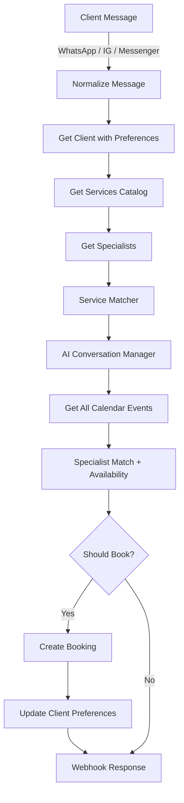
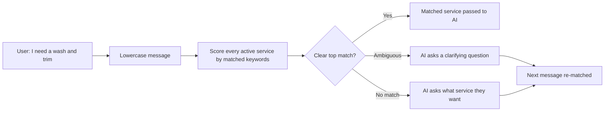
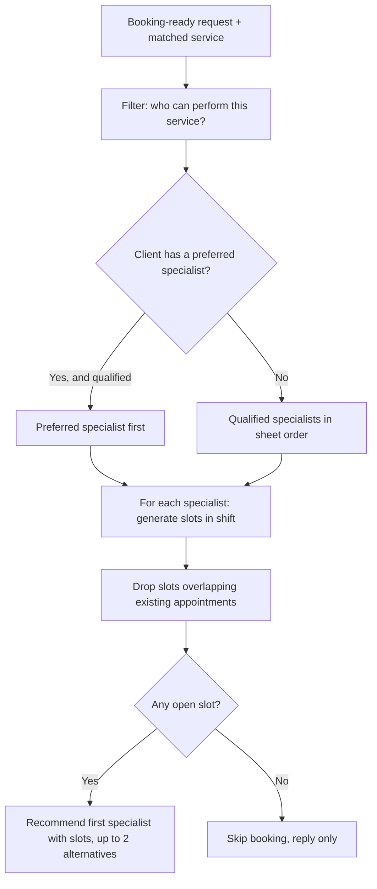
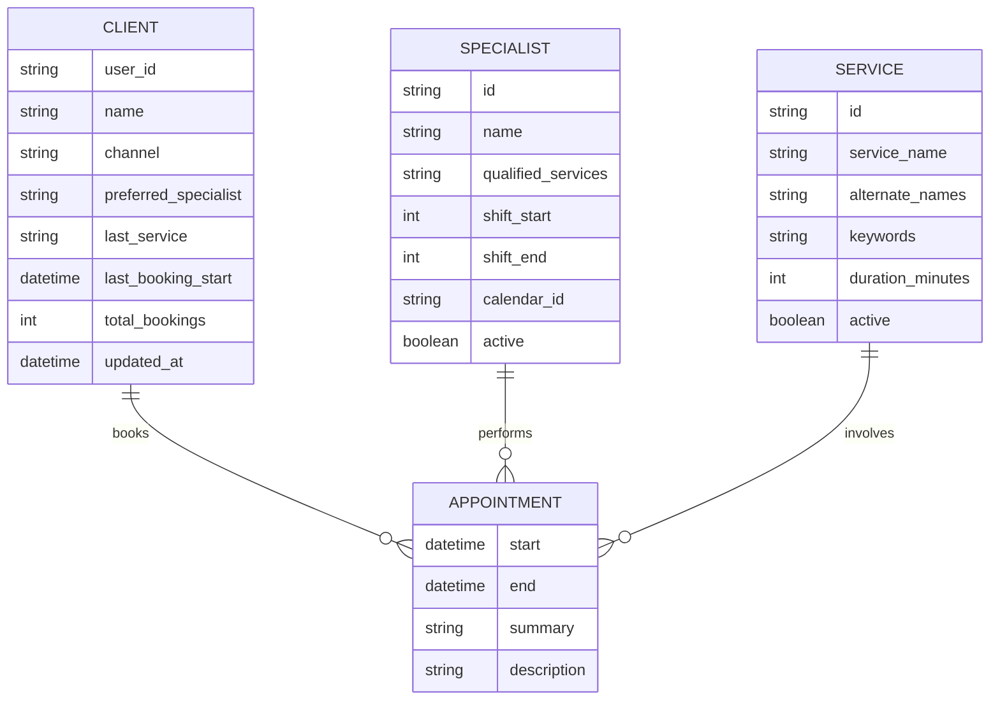
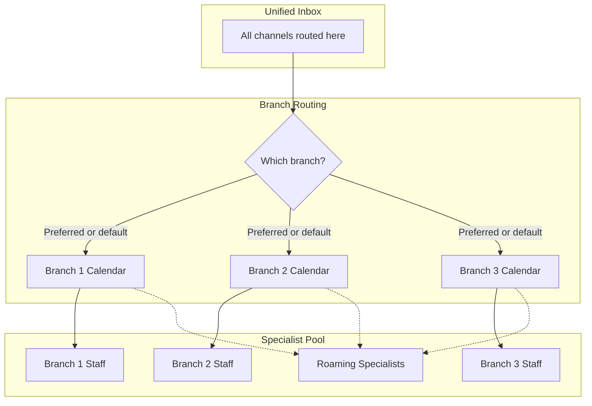
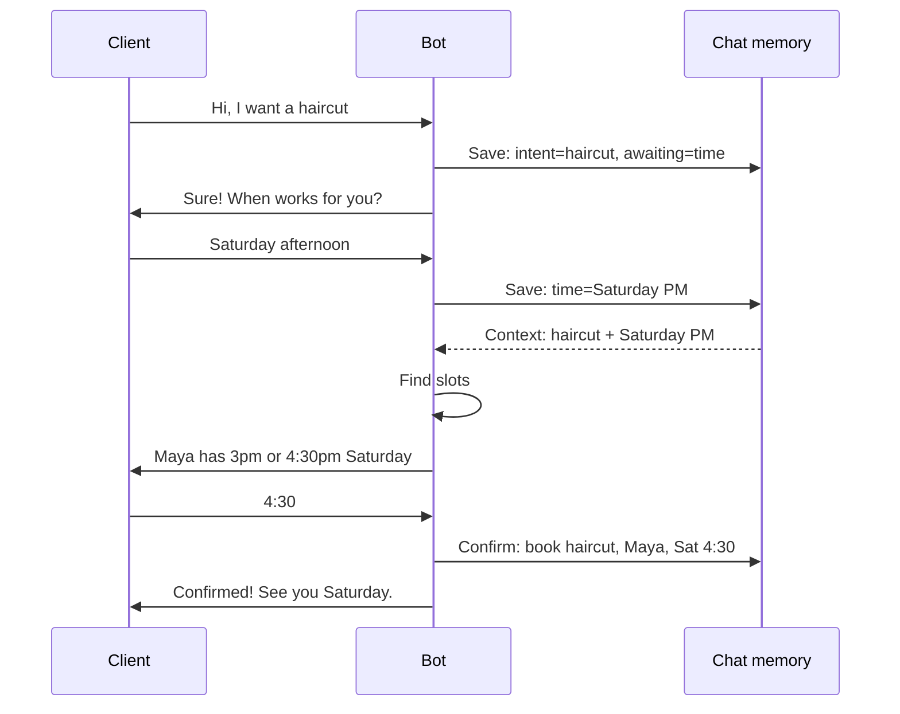

# Architecture — Beauty Center AI Reception

Multi-channel reception system for beauty and wellness businesses: service matching from informal language, qualified-specialist booking with conflict checks, and preference-aware personalization. This document covers the exported [`workflow.json`](./workflow.json) and marks where production-only components take over.

---

## System overview

The lookups run sequentially rather than in parallel. In n8n, a node fed by several parents runs once per parent, which would repeat the AI call and the booking. Chained lookups (with empty results passed through for first-time clients) guarantee one AI call and at most one booking per inbound message.

## Service matching strategy

Beauty services have many informal names. Matching is deterministic code, not a model guess.

- Each service's keywords are its name, `alternate_names` and `keywords` columns from the `Services` sheet
- Each matched keyword adds its length to the score, so longer, more specific matches win
- If the runner-up scores at least 70% of the top match, the request is flagged ambiguous

**Service keyword examples:**

| Service | Keywords |
|---|---|
| Haircut | haircut, trim, cut, hair cut, fix my hair |
| Color | color, dye, highlights, balayage, ombre, root touch up |
| Manicure | manicure, nails, mani, gel, polish, nail art |
| Pedicure | pedicure, feet, pedi, toes |
| Facial | facial, face treatment, skincare, cleansing |
| Waxing | wax, waxing, eyebrow, leg wax, brazilian |

## Specialist matching

- **Slots:** 30-minute steps inside the specialist's `shift_start`–`shift_end` (defaults 10:00–19:00), sized to the service's `duration_minutes`
- **Lead time:** no slot earlier than 30 minutes from now
- **Window:** from the requested date (or tomorrow) for up to 7 days; up to 3 slots per specialist
- **Booking:** the first slot of the recommended specialist is written to Google Calendar

## Client record

Every booking upserts the client's row in the `Clients` sheet, matched on `user_id`:

**What carries forward:** the specialist from the latest booking becomes `preferred_specialist` and is offered first next time. The AI also receives the full client record, so it can personalize the reply (returning client vs. new client, multi-branch options only for new clients).

## Production-only components (not in this export)

### Multi-branch routing

The export books against one appointment calendar (`BEAUTY_CALENDAR_ID`).

### Service-aware follow-up cadence

Different services have different natural rebooking windows. The production follow-up agent schedules rebook reminders accordingly:

| Service | Typical rebook timing |
|---|---|
| Haircut | ~4 weeks |
| Color/Highlights | ~6 weeks (root touch-up) |
| Manicure | ~2 weeks |
| Facial | ~6 weeks |
| Waxing | ~3 weeks |
| Lashes | ~3 weeks |
| Massage | ~4 weeks |

### Multi-turn conversation memory

The export carries context through the client record only; turn-by-turn chat memory is part of the production deployment.

## Reliability features

- **Exactly-once AI call and booking per message** — sequential lookups, no fan-in
- **No double bookings** — every slot is checked against existing appointments before it is offered or booked
- **Deterministic matching and selection** — the model never picks the service, specialist or slot
- **Idempotent client records** — upserted on `user_id`
- **Node-level retries** — 3 tries, 2 s apart on every read, AI call and client upsert; none on the booking write, so a timeout can never duplicate an appointment
- **Shared error handler** — sanitized logging, Slack alert on high-severity failures (booking, calendar, auth)
- **Safe reply encoding** — the webhook response is built with `JSON.stringify`, so quotes or line breaks in a reply never break the payload

## Performance characteristics

- **Channels unified:** WhatsApp, Instagram, Messenger (Telegram payloads also parsed)
- **Response time:** 60–90 s typical end to end (3 min P95); under 90 s met 96% of the time
- **Service matching:** 86% correct on the first message (500-booking audit)
- **Double bookings:** 0
- **Preferred specialist:** 78% of clients booked with their preferred specialist when available
- **Client lifetime value:** estimated +25% vs pre-automation

Full data in [`PERFORMANCE.md`](./PERFORMANCE.md).
