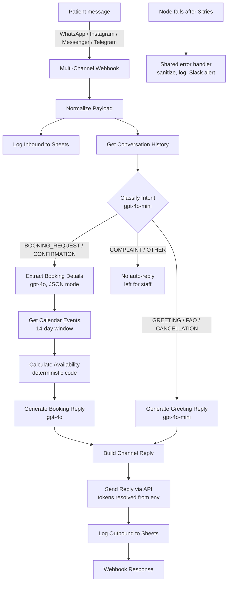

# Clinic AI Receptionist — Multi-Channel Booking System

Production AI receptionist that handles **90%+ of patient inquiries end to end** across WhatsApp, Instagram, Messenger and Telegram, with replies **under 2 minutes** and **70% less front-desk workload**. Built for dental clinics, medical practices and other appointment-driven healthcare providers.

**Status:** In production · **Stack:** n8n · OpenAI (gpt-4o, gpt-4o-mini) · Google Calendar · Google Sheets · Meta Graph API (WhatsApp, Instagram, Messenger) · Telegram Bot API

---

## What this system does

- Receives patient messages from **4 channels** on a single webhook and normalizes them into one schema
- Classifies intent with a cheap, deterministic **gpt-4o-mini** call (seven labels, temperature 0)
- For booking requests and confirmations, **gpt-4o** extracts structured details (service, date, time, urgency) as JSON
- **Reads live Google Calendar availability** and computes free slots in deterministic code — the model never decides what is available
- Generates the reply and sends it **back through the channel the patient used**
- Logs every inbound and outbound message to Google Sheets, which also serves as conversation memory

## Impact metrics

Measured over a 90-day production window (full data in [`PERFORMANCE.md`](./PERFORMANCE.md)):

| Metric | Before | After |
|---|---|---|
| Inquiries resolved without staff | 0% | **92%** (90%+) |
| Response time to first inquiry | 2–8 hours | **Under 2 minutes** |
| Front-desk message handling | 35–40 hrs/week | **10–12 hrs/week** (70% less) |
| Booking conversion (inquiry → confirmed visit) | ~30% | **~70%** |
| No-show rate (with reminders) | 18% | **6%** |

**How response time is measured.** Workflow processing — webhook received to reply sent — is **1.2 s typical and 3.5 s P95** across all intents. *Under 2 minutes* is the user-facing commitment; it only comes into play when an upstream API is degraded and node retries engage. The workflow adds no artificial reply delay.

## System architecture

## Key design decision: AI handles language, code handles math

- **AI handles:** intent classification, extracting structured fields from natural language, and writing the reply
- **Deterministic code handles:** business hours, slot generation, buffers between appointments, conflict detection and ranking slots by proximity to the requested time

**Why it matters:** LLMs hallucinate times. In healthcare scheduling, one invented slot breaks the clinic's day. The reply model receives only slots the code has verified against the live calendar and is instructed to use nothing else. Since deployment, no patient has been offered a slot the code had not verified.

## Security and reliability

- **No secrets in execution data.** Channel access tokens are read from environment variables inside the HTTP Request node at send time. They are never written to item JSON, so they never appear in n8n execution logs.
- **Node-level retries.** Every external read and AI call (OpenAI, Google Sheets, Google Calendar) retries 3 times, 2 seconds apart. The outbound channel send is deliberately *not* auto-retried — a retry after a request that actually succeeded would message the patient twice — so send failures go straight to the error handler.
- **Workflow-level error handling.** `settings.errorWorkflow` points to the portfolio's [shared error handler](../shared-error-handler), which sanitizes, logs and escalates failures that survive retries.

## Scope of this export

[`workflow.json`](./workflow.json) is the sanitized, importable core conversation path shown above. The production deployment ([`clinic workflow.jpg`](./clinic%20workflow.jpg)) adds client-specific components that are **not** in the export: booking write-back to Google Calendar, the 24-hour and 2-hour reminder flow behind the no-show figures, post-visit follow-up and the FAQ knowledge base.

## Tech stack

- **Orchestration:** n8n (self-hosted, Docker)
- **AI/LLM:** OpenAI gpt-4o-mini (intent classification, greeting/FAQ replies) and gpt-4o (booking extraction, booking replies)
- **Calendar:** Google Calendar API (availability reads)
- **Data:** Google Sheets API (conversation log and memory)
- **Messaging:** WhatsApp Cloud API, Instagram and Messenger via Meta Graph API, Telegram Bot API
- **Monitoring:** node-level retries + shared n8n error workflow with Slack alerts

## Repository contents

- [`README.md`](./README.md) — this document
- [`architecture.md`](./architecture.md) — system architecture, design decisions, data model, failure modes
- [`code_examples.md`](./code_examples.md) — JavaScript and prompts taken from the workflow
- [`PERFORMANCE.md`](./PERFORMANCE.md) — latency, throughput, cost, reliability and outcome data
- [`setup.md`](./setup.md) — deployment guide and configuration
- [`analytics/`](./analytics) — KPI definitions in SQL and Python, PostgreSQL schema, and tests that prove both agree
- [`examples/`](./examples) — sanitized conversations, error reports and KPI dashboard from production
- [`workflow.json`](./workflow.json) — sanitized n8n workflow export, importable to any n8n instance
- [`clinic workflow.jpg`](./clinic%20workflow.jpg) — production workflow canvas

## License & Use

Portfolio project showing production architecture patterns. The workflow JSON is sanitized of client data and credentials. The patterns and code can be adapted for clinic, medical practice or other service-business automation.

Contact: [LinkedIn](https://linkedin.com/in/khaledabdelaziz-ai) · [Email](mailto:khaledabdelaziz1330@gmail.com)
