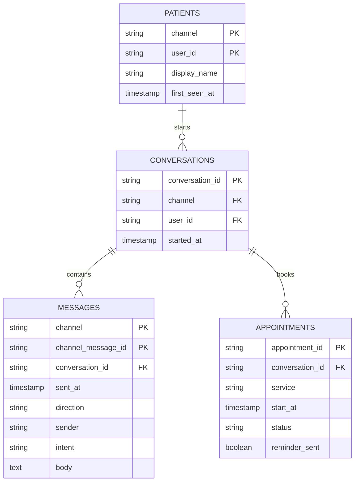

# Clinic KPI Analytics — Python + SQL

The [outcome metrics](../PERFORMANCE.md#outcome-metrics) for the Healthcare AI Receptionist — automation rate, response time, booking conversion, no-show rate — defined precisely in **SQL** and **Python**, plus the **PostgreSQL schema** that replaces the Google Sheets log once volume outgrows it.

Both implementations compute the same metrics independently, and the tests prove they agree — on SQLite locally and on a real PostgreSQL 16 server in CI.

| File | What it is |
|---|---|
| [`schema.sql`](./schema.sql) | Relational data model: patients, conversations, messages, appointments — with idempotency and integrity constraints |
| [`kpis.sql`](./kpis.sql) | KPI queries: automation rate, booking conversion, no-show rate with/without reminders, bookings by channel |
| [`kpi_report.py`](./kpi_report.py) | Reads a CSV export of the conversation log and prints a KPI report (Python 3.10+, standard library only) |
| [`test_analytics.py`](./test_analytics.py) | Hand-checked KPIs, SQL-vs-Python agreement on SQLite, schema guards |
| [`test_postgres.py`](./test_postgres.py) | The same SQL-vs-Python agreement on PostgreSQL (runs in CI) |
| [`sample_data/`](./sample_data) | **Synthetic** export (16 conversations, 52 messages, 8 appointments) — not patient data |

## Run it

```bash
cd clinic-booking-system/analytics
python3 kpi_report.py sample_data          # or point it at a real export folder
python3 -m unittest -v                      # tests (PostgreSQL tests skip unless PGHOST is set)
```

Output on the synthetic sample:

| Metric | Value |
|---|---|
| Conversations | 16 |
| Automation rate (no staff message) | 87.5% |
| First response — P50 / P95 | 3 s / 118 s |
| Replied within 2 minutes | 100% |
| Booking conversion | 77.8% (7 of 9) |
| No-show rate, with reminder | 25% (1 of 4) |
| No-show rate, without reminder | 50% (1 of 2) |
| Bookings by channel | whatsapp 4, instagram 1, messenger 1, telegram 1 |

## KPI definitions

| Metric | Definition | SQL | Python |
|---|---|---|---|
| **Automation rate** | Conversations with no staff message ÷ all conversations | `automation_rate` | `compute_kpis` |
| **First-response time** | Patient's first message → first reply after it (AI or staff); P50 / P95, nearest-rank | — | `first_response_seconds`, `percentile` |
| **Replied within 2 minutes** | Share of first responses ≤ 120 s — the clinic's user-facing commitment | — | `compute_kpis` |
| **Booking conversion** | Conversations with a `BOOKING_REQUEST` that ended in a confirmed appointment ÷ conversations with a `BOOKING_REQUEST` | `booking_conversion` | `compute_kpis` |
| **No-show rate** | No-shows ÷ completed appointments (attended + no-show), split by reminder sent | `no_show_rate` | `compute_kpis` |
| **Bookings by channel** | Non-cancelled appointments per channel | `bookings_by_channel` | `compute_kpis` |

Percentages are rounded half-up to one decimal in both implementations, so they match exactly. Response-time percentiles are computed in Python because date arithmetic is not portable across SQL engines.

## Data model



Design decisions:

- **Idempotency in the database.** A message's primary key is the platform's own message id (`channel`, `channel_message_id`), so a webhook retry can never be stored twice — the guarantee the Sheets log can only approximate.
- **Constraints mirror the workflow.** `intent` accepts exactly the classifier's seven labels; an inbound message must come from the patient and an outbound one from AI or staff; appointment status is one of `booked`, `attended`, `no_show`, `cancelled`.
- **A conversation is one inquiry,** a 24-hour window that matches WhatsApp's customer-service window.
- **Personal data is minimal and time-limited.** Message bodies are the only free text and follow the 90-day retention in [`SECURITY.md`](../../SECURITY.md).
- **Portable SQL.** The schema and queries run unchanged on PostgreSQL 13+ and SQLite 3.35+.
