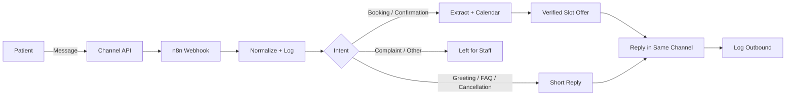
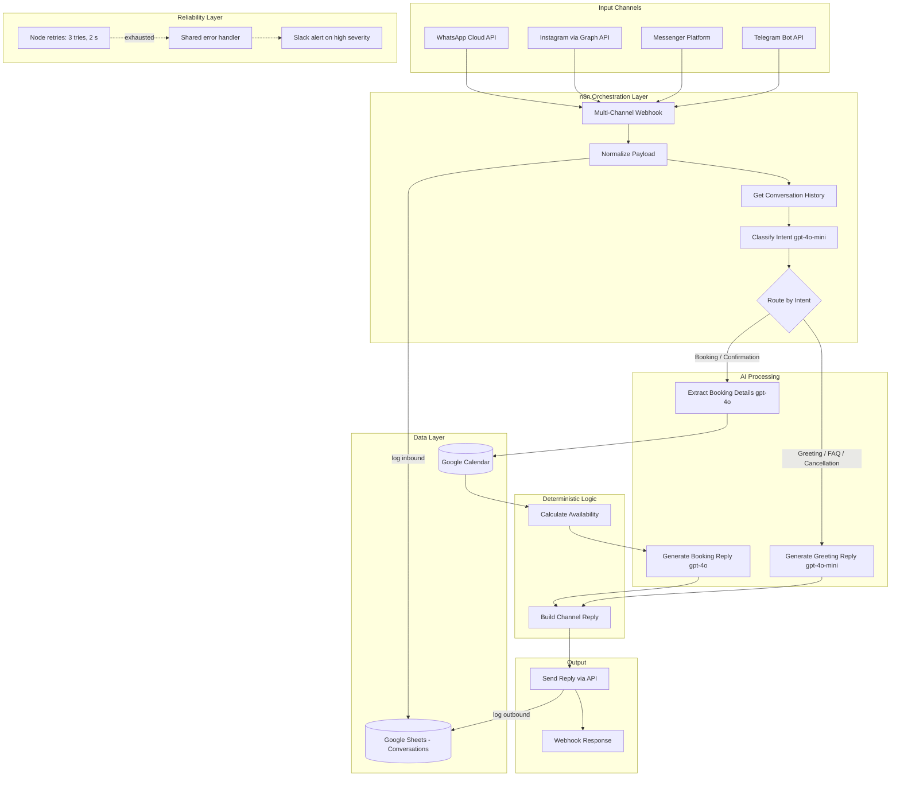

# Architecture — Healthcare AI Receptionist

System architecture, design decisions and data flow for the exported workflow ([`workflow.json`](./workflow.json)).

---

## High-level data flow

## Detailed component breakdown

## Design decisions and rationale

### 1. Single normalizer for multi-channel input

**Decision:** All four channels post to one webhook. A JavaScript normalizer detects the source from the payload shape and converts it into one schema (`channel`, `user_id`, `user_name`, `message_text`, `message_type`, `message_id`, `timestamp`).

**Why:** Classification, extraction, availability and logging should not know which channel a message came from. This keeps the system maintainable when:
- A channel is added (one new detection branch)
- A platform changes its payload (one node changes)
- A clinic moves patients between channels

**Trade-off:** One extra processing step (~30 ms). Worth it for maintainability.

### 2. Intent classifier as a separate cheap call

**Decision:** The first OpenAI call only classifies intent — one of seven labels (`BOOKING_REQUEST`, `CONFIRMATION`, `FAQ`, `CANCELLATION`, `GREETING`, `COMPLAINT`, `OTHER`). Detailed processing happens only in the relevant branch.

**Why:**
- gpt-4o-mini at temperature 0 with 10 max tokens costs ~$0.00005 per call
- Expensive gpt-4o extraction never runs on greetings or FAQs
- Each prompt has one job, which keeps it short and testable

**Routing:** booking requests and confirmations go to extraction; greetings, FAQs and cancellations get a short gpt-4o-mini reply; complaints and anything unclassified fall through the switch's fallback output with no automated reply, so staff handle them from the conversation log.

### 3. AI extracts data, code verifies availability

**Decision:** gpt-4o extracts the preferred date and time; a deterministic Code node computes availability from the live calendar.

**Why:** LLMs hallucinate. A model that says "Tuesday at 3 PM is available" without checking creates double bookings.

**Implementation (`Calculate Availability`):**
- Business hours 09:00–19:00, 30-minute slots, 15-minute buffer around existing events
- 30-minute minimum lead time; Fridays closed
- Starts at the requested date and scans forward up to 7 days until at least 5 free slots are found
- Returns the 3 slots closest to the preferred time, formatted in the clinic's timezone
- All slot math runs in clinic time (`Africa/Cairo`, daylight-saving aware) regardless of the server's time zone — a UTC server still offers 09:00–19:00 Cairo time
- Covered by automated tests in [`tests/clinic.test.js`](../tests/clinic.test.js)

The reply model receives only these slots and is instructed: *"Do NOT make up slot times. Use ONLY what is provided."* The model never decides availability; only the code does.

### 4. Secrets resolved at request time, never stored in item data

**Decision:** `Build Channel Reply` produces only the channel-specific message body. The endpoint URL and the `Authorization` header are built inside `Send Reply via API` from environment variables (`$env.WHATSAPP_ACCESS_TOKEN`, `$env.IG_ACCESS_TOKEN`, `$env.FB_PAGE_ACCESS_TOKEN`, `$env.TELEGRAM_BOT_TOKEN`).

**Why:** n8n stores every node's output in execution data. A token written into item JSON would be readable by anyone with access to execution history. Resolving it in the request node's parameters keeps it out of stored output. Telegram's Bot API carries the token in the URL path by design, so the URL is built the same way.

### 5. Conversation history retrieved per turn

**Decision:** Before classification, the workflow looks up the patient's rows in the `Conversations` sheet. The extraction prompt receives the last 5 messages plus the latest one.

**Why:**
- Patients refer back to earlier turns ("yes, the 3 PM works")
- Context survives without long-running stateful sessions
- Google Sheets is the source of truth, so conversation state survives any n8n restart

The lookup returns one item per logged row, so `Classify Intent` is set to execute once: each inbound message produces exactly one classification and one reply, however long the history.

### 6. Two layers of error handling

**Decision:** Every external API node retries 3 times, 2 seconds apart. Failures that survive retries go to the portfolio's [shared error handler](../shared-error-handler) through `settings.errorWorkflow`.

**Why:** Silent failures are the most common cause of broken production automation. With this pattern:
- Transient errors (rate limits, brief network issues) recover without anyone noticing
- Persistent failures are logged with workflow, node and execution ID
- Secrets and PII are sanitized before anything is logged or alerted
- High-severity failures (channel send, calendar, auth) reach Slack

## Data model

### Conversation log (Google Sheets, `Conversations` tab)

Written by `Log Inbound to Sheets` and `Log Outbound to Sheets`; read by `Get Conversation History`.

| Column | Type | Description |
|---|---|---|
| timestamp | datetime | When the message was received or sent |
| user_id | string | Channel-specific user identifier |
| user_name | string | Patient's display name (where the channel provides it) |
| channel | enum | whatsapp / instagram / messenger / telegram |
| direction | enum | inbound / outbound |
| message_text | text | The message content |
| intent | enum | Classified intent (outbound rows) |
| status | enum | received (inbound) / sent (outbound) |

An inbound row with no matching outbound row is the signal for staff follow-up.

## Failure modes and recovery

| Failure | Detection | Recovery |
|---|---|---|
| OpenAI API error or rate limit | Node error on any OpenAI node | 3 tries, 2 s apart; then logged by the shared handler (rate limits are low severity) |
| Calendar API failure or expired OAuth | `Get Calendar Events` error | Retried; auth failures escalate as high severity to Slack for re-authorization |
| Channel send failure (expired token, disconnected account) | `Send Reply via API` error, 10 s timeout per attempt | 3 tries; then high-severity Slack alert |
| Malformed or unsupported payload | `Normalize Payload` throws | Logged by the shared handler; no reply sent |
| Unclassifiable message | Switch fallback output | No automated reply; inbound row stays in the log for staff |

## Performance characteristics

- **Processing time:** 1.2 s typical, 3.5 s P95 (webhook received → reply sent, all intents)
- **User-facing commitment:** reply in under 2 minutes
- **Throughput:** tested to 50 concurrent conversations
- **Cost:** ~$0.008–0.020 per conversation (3–4 turns), mostly WhatsApp session cost plus OpenAI
- **Reliability:** 99.4% execution success rate over 90 days

Full data in [`PERFORMANCE.md`](./PERFORMANCE.md).

## Scope of this export

The production deployment ([`clinic workflow.jpg`](./clinic%20workflow.jpg)) runs additional client-specific components that are not in `workflow.json`:

- Booking write-back to Google Calendar once a patient confirms a slot
- 24-hour and 2-hour appointment reminders (the source of the no-show reduction)
- Post-visit follow-up
- FAQ knowledge base

## What's deliberately NOT in this system

- **Payment processing** — handled by staff for security and trust
- **Medical advice** — prompts are scoped to scheduling and short front-desk replies
- **Complex rescheduling** — cancellation messages get a short reply; changes are made by staff
- **Emergency triage** — the extractor tags urgency, but the workflow does not route on it; emergency handling stays with clinic staff and phone lines
