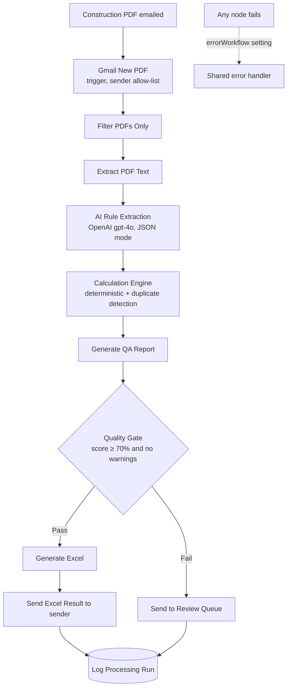
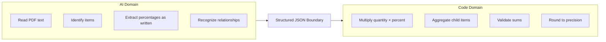
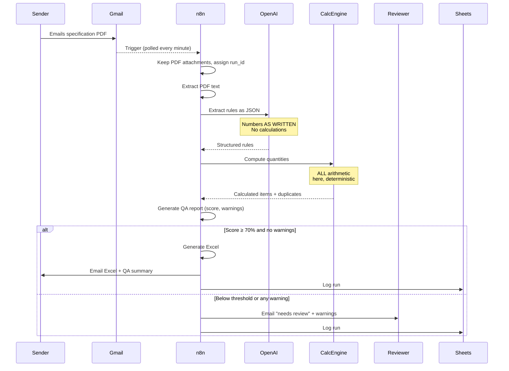

# Architecture — Document Automation System

PDF-to-Excel pipeline for construction specifications. **Core principle: AI for language, code for math.** The LLM never touches arithmetic.

---

## System diagram



## Critical principle visualization



**Why the split is rigid:** LLMs are unreliable at arithmetic. In construction documents, a wrong calculation means real money lost or safety issues. Forcing arithmetic into deterministic code removes that error class; what remains is extraction error, which the QA layer is built to surface.

## Processing flow



## Data transformation example

**Input PDF text:**
```
Item A (parent):
  Total quantity: 1000 units
  Sub-items:
    - Item A-1: 600 units (reuse 50%, dispose 30%, clean 20%)
    - Item A-2: 400 units (reuse 70%, dispose 20%, clean 10%)
```

**After AI extraction (JSON):**
```json
{
  "rules": [
    {
      "item_name": "Item A",
      "parent_item": null,
      "quantity": 1000,
      "actions": null
    },
    {
      "item_name": "Item A-1",
      "parent_item": "Item A",
      "quantity": 600,
      "actions": { "reuse_percent": 50, "dispose_percent": 30, "clean_store_percent": 20 }
    },
    {
      "item_name": "Item A-2",
      "parent_item": "Item A",
      "quantity": 400,
      "actions": { "reuse_percent": 70, "dispose_percent": 20, "clean_store_percent": 10 }
    }
  ]
}
```

**After deterministic calculation:**
```
Item A-1: reuse 300, dispose 180, clean_store 120 (sums to 600 ✓)
Item A-2: reuse 280, dispose 80, clean_store 40 (sums to 400 ✓)
Item A (parent): 2 children, children total qty 1000
```

**Final Excel output:** a spreadsheet of the calculated values, emailed back to the sender together with the QA score and warning count.

## Quality assurance layer

Every run generates a QA report:

| QA Check | What it validates | Effect |
|---|---|---|
| **Percent balance** | Each item's action percentages sum to 100% | Warning + lowers score |
| **Duplicate detection** | No item name appears twice in the extraction | Warning + lowers score |
| **Quantity validity** | Each item has a positive numeric quantity | Warning (`invalid_quantity`) |
| **Completeness** | Share of items with a stated quantity | Lowers score |
| **Quantity conservation** | Computed action quantities sum to the item quantity | Reported per item (`quantity_balanced`) |
| **Parent aggregation** | Child count and total child quantity per parent | Reported per parent |
| **Action coverage** | Share of items with action rules | Recommendation if under 80% |

**Quality score formula:**
```
score = (balanced_items / total_items) * 0.5
      + (no_duplicates ? 1 : 0.5) * 0.3
      + (completeness_ratio) * 0.2
```

**Gate:** a run auto-exports only when the score is ≥ 70% **and** the warnings list is empty. Any blocking warning routes the run to human review regardless of score.

## Reliability features

| Feature | Implementation |
|---|---|
| **Deterministic downstream** | Given the same extraction, calculations, QA score and gate decision are reproducible; extraction runs at temperature 0 in JSON mode |
| **Auditable runs** | Every PDF gets a `run_id`, carried into emails and the Google Sheets processing log |
| **QA report per run** | Operator sees score, warnings and recommendations for every document |
| **Graceful degradation** | Low-quality outputs route to humans, never silently shipped |
| **Fail fast** | Emails without PDFs, and extractions with zero rules, stop the run with an explicit error |
| **Centralized error handling** | Failures go to the [shared error handler](../shared-error-handler) via the `errorWorkflow` setting |

## Performance characteristics

Summary of [PERFORMANCE.md](PERFORMANCE.md):

- **Processing time:** 15–30 seconds per PDF typical, ~60 s P95
- **Cost per document:** ~$0.03–0.05 (gpt-4o extraction)
- **Arithmetic:** 100% correct by construction (deterministic code, given the extracted inputs)
- **Extraction accuracy:** 94–97% on item names, quantities and percentage rules; 88% on parent-child relationships
- **Threshold pass rate:** 84% of runs score ≥ 70%; the remaining 16% always go to human review
