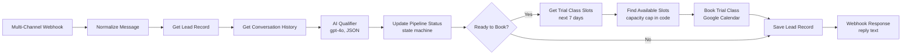

# Fitness Lead-to-Member Pipeline

Multi-channel lead capture and trial-booking pipeline for gyms and fitness centers
(WhatsApp · Instagram · Facebook Messenger)

**Status:** In production at a single gym location — **1,450 inbound messages over 90 days**, converted into **522 trial bookings** and **137 new members** (9.4% inbound → member). Full data in [`PERFORMANCE.md`](./PERFORMANCE.md).

---

---

## Workflow Architecture

The exported [`workflow.json`](./workflow.json) implements the core inbound path:

The production canvas above adds per-channel triggers and outputs and a scheduled follow-up agent; see [Scope of this export](#scope-of-this-export).

---

## What This System Does

Turns every gym inquiry from **WhatsApp / Instagram / Messenger** into a structured lead record and, once the lead is qualified, a booked trial class.

- Captures every inquiry on a single webhook, whatever the channel
- Qualifies leads conversationally (goals, experience level, preferred time) with gpt-4o
- Moves each lead through explicit statuses: **New → Hot → Trial Booked**
- Books the trial in Google Calendar only where the class still has capacity
- Keeps one upserted row per lead in Google Sheets — a simple CRM for the gym team

---

## How It Works

1. **Lead sends a message on any channel**
   Usually from a paid ad, story or profile button. The normalizer maps every payload to one schema.

2. **AI qualifier replies**
   - Reads the existing lead record and the last 5 conversation turns
   - Asks short questions to collect name, phone, fitness goal, experience and preferred time
   - Returns structured JSON: the reply, the collected fields, a `ready_to_book` flag and a detected intent
   - Hard rules in the prompt: no promised results, no membership prices, no medical claims, human handoff if the lead is frustrated

3. **Pipeline status update**
   - A deterministic state machine maps the detected intent to the next status (`New` → `Hot` once the lead is booking-ready)
   - Status changes are decided in code, not by the model

4. **Trial booking**
   - Reads the trial calendar for the next 7 days
   - Applies the fixed weekly trial schedule and a cap of 5 attendees per slot
   - Books the earliest open slot and marks the lead `Trial Booked`

5. **Lead record**
   - Upserts the lead on `user_id` with status, collected details, trial start time and timestamp
   - Returns the AI reply in the webhook response

---

## Results

Measured at one gym over 90 days:

| Stage | Count | Conversion |
|---|---|---|
| Inbound messages | 1,450 | — |
| Qualified leads (Hot) | 870 | 60% |
| Trial bookings | 522 | 60% of qualified |
| Trial attendees | 392 | 75% of bookings |
| New members | 137 | 35% of attendees |
| **End to end (inbound → member)** | **137** | **9.4%** |

- **~46 new members per month** from inbound messaging alone
- **~30 hours/week** of front-desk message handling replaced
- **~14% of trial no-shows recovered** by the production follow-up sequence
- **0 overbooked trial classes** — capacity is enforced in code

**How response time is measured.** End to end — inbound message to reply sent to the channel — is **60–90 s typical, 3 min P95**, with the under-90-second target met 95% of the time. In-workflow processing is seconds: lead lookup ~200 ms, AI qualification 1–2 s, booking ~500 ms.

---

## Stack

| Layer | Tools |
|---|---|
| **Orchestration** | n8n (self-hosted on VPS) |
| **AI** | OpenAI gpt-4o (qualification, reply and intent detection in one JSON call) |
| **Channels** | WhatsApp, Instagram, Messenger (Telegram payloads are also parsed) |
| **Data** | Google Sheets (lead records, conversation history) |
| **Scheduling** | Google Calendar (trial class bookings) |
| **Reliability** | Node-level retries + [shared error handler](../shared-error-handler) |

---

## Scope of this export

`workflow.json` is the sanitized, importable inbound pipeline shown above. The production deployment adds client-specific components that are **not** in the export:

- Per-channel triggers and reply delivery (the export returns the reply in the webhook response)
- The scheduled follow-up agent: pre-trial reminders, the 3-step no-show recovery sequence and post-trial membership follow-up
- Later pipeline statuses (Attended, Member, Lost), which are set downstream of this workflow

---

## Notes

- Status names, qualification questions, trial schedule and capacity are configurable per gym
- Can start with WhatsApp only and add channels later
- Every external read, AI call and lead upsert retries 3 times, 2 seconds apart; the calendar booking write does not, so a retry can never create a duplicate trial. Persistent failures go to the shared error handler, which sanitizes, logs and alerts
