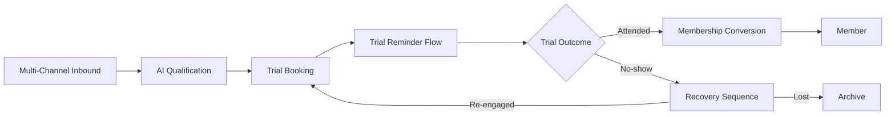
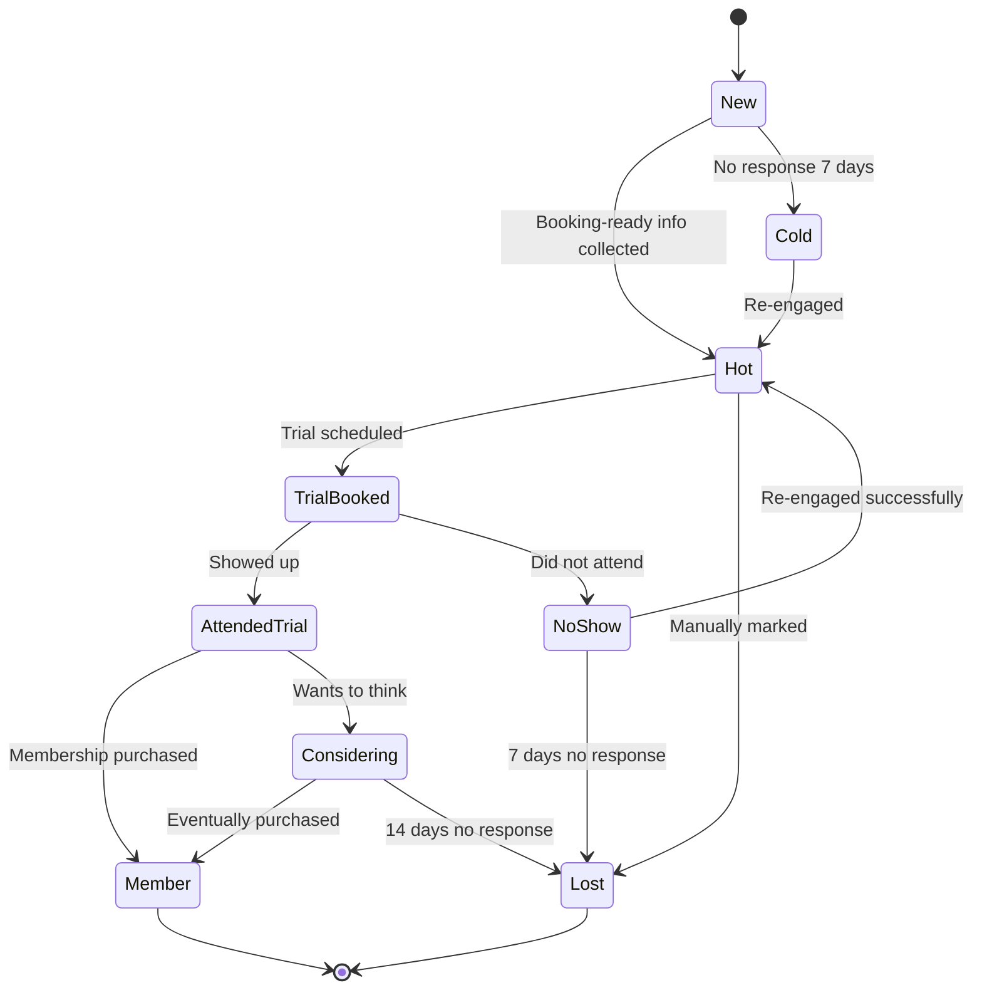
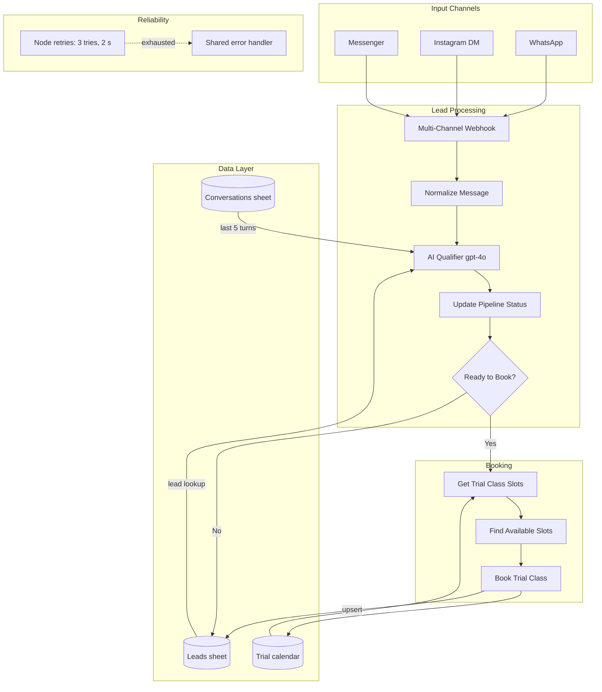
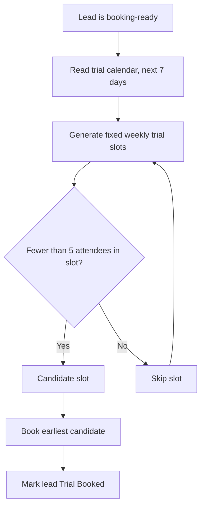

# Architecture — Fitness Lead-to-Member Pipeline

Pipeline tracking from first inbound message to booked trial, in production at one gym location (1,450 inbound messages over 90 days). This document covers the exported [`workflow.json`](./workflow.json) and marks where the production follow-up layer takes over.

---

## High-level flow

Inbound, qualification and trial booking are in `workflow.json`. Reminders, recovery and membership conversion run in the production follow-up agent.

## Lead pipeline state machine

**Written by this workflow:** `New`, `Hot` and `Trial Booked`. The `Update Pipeline Status` Code node maps the AI's `detected_intent` to the next status through an explicit transition table, and `Save Lead Record` writes `Trial Booked` whenever the booking branch ran. All later states are set downstream by the follow-up agent or by staff.

## Component diagram

The workflow reads the `Conversations` sheet for context but does not write it; in production it is populated outside this export.

## Capacity management

Trial classes have limits, and the limit is enforced in code — never by the model:

- **Weekly schedule:** Monday–Friday at 09:00, 11:00, 17:00 and 19:00; Saturday and Sunday at 10:00, 12:00 and 14:00
- **Capacity:** 5 attendees per slot, counted from existing calendar events at that start time
- **Window:** from tomorrow through the next 7 days; the first 3 open slots are kept
- **No open slot:** the export has no waitlist branch — the booking step fails loudly and the shared error handler alerts staff

## Conversational qualification

Instead of forms, the AI gathers qualification info over the conversation:

| Info needed | How collected |
|---|---|
| Name | Asked early if not in greeting |
| Fitness goals | Open-ended question, AI parses response |
| Experience level | Asked after goals |
| Preferred training time | Asked when ready to book |
| Preferred location | Asked if the gym has more than one branch |

The AI returns a single JSON object per turn: `reply_to_user`, `collected_info`, `ready_to_book` and `detected_intent` (`greeting`, `qualifying`, `booking_ready`, `complaint`, `other`). Code, not the model, decides what that intent means for the lead's status.

## Production follow-up layer (not in this export)

The production deployment runs a scheduled follow-up agent on top of the lead sheet.

### Reminder sequence design

```mermaid
gantt
    title Trial Reminder Timeline
    dateFormat HH:mm
    axisFormat %H:%M

    section Day -1
    24h reminder           :r24, 18:00, 1h

    section Day 0
    2h reminder            :r2, 13:00, 30m
    Trial class            :trial, 15:00, 1h
    Post-trial follow-up   :post, 17:00, 1h

    section Day +1
    Membership offer       :offer, 09:00, 4h

    section Day +3
    Soft check-in          :check, 09:00, 4h
```

### No-show recovery sequence

When a lead misses a trial, a 3-step sequence runs over 7 days:

1. **+4 hours** — Soft check-in ("everything okay?")
2. **+48 hours** — Value reminder ("trial is still available, no pressure")
3. **+7 days** — Final offer ("last note, want to give it a shot?")

The sequence is **cancelled** if the lead responds, or is moved to `Member` or `Lost`. This prevents the "we already joined and you're still messaging us" problem.

## Performance characteristics

- **Volume:** 1,450 inbound messages over 90 days at one location
- **Response time:** 60–90 s typical end to end (3 min P95); under 90 s met 95% of the time
- **Trial booking conversion (Hot → Trial Booked):** 60%
- **Trial attendance rate (with reminders):** 75%
- **Member conversion (Attended → Member):** 35%
- **End-to-end conversion (Inbound → Member):** 9.4%
- **No-show recovery:** 20% re-engaged; ~14% of all no-shows attend a trial

Full data in [`PERFORMANCE.md`](./PERFORMANCE.md).

## Reliability features

- **Exactly-once AI and booking steps** — lookups run sequentially (empty results still pass through for first-time leads), so each inbound message triggers one AI call and at most one booking
- **Status changes in code** — an explicit transition table, never a model decision
- **Capacity checks before booking** — no overbooked trial classes
- **Idempotent lead records** — upserted on `user_id`, so a replayed message never creates a duplicate lead
- **Node-level retries** — 3 tries, 2 s apart on every read, AI call and lead upsert
- **No retry on the booking write** — a timeout can never produce a duplicate calendar event
- **Shared error handler** — sanitized logging, Slack alert on high-severity failures (booking, calendar, auth)
- **Single normalized schema** — no channel-specific logic downstream of the webhook
