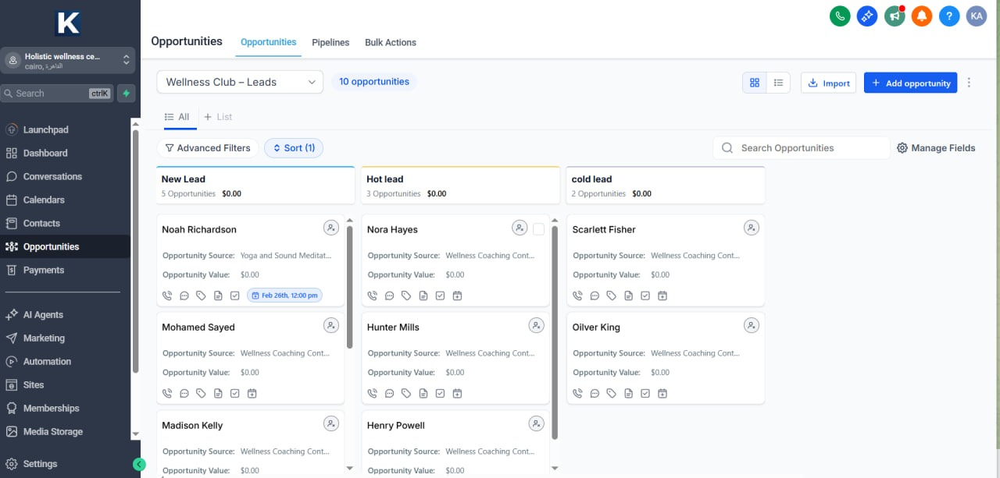

# Client Lifecycle System — Wellness Club (GoHighLevel + n8n)

End-to-end automation system for a wellness club offering yoga, meditation, retreats, and holistic cooking programs
(GoHighLevel · n8n · JavaScript · Google Sheets · Email / SMS)

**Status:** Built and tested end-to-end in a GoHighLevel staging sub-account (February 2026). GHL workflows are in Draft and have not yet been enrolled with live clients.

---

---

## What This System Does

A two-layer automation system: **GoHighLevel (GHL)** runs the client journey, and **n8n** is the backend logging and reliability layer. Built for a holistic wellness club that wanted to stop handling bookings, reminders, and attendance tracking by hand.

**Problems addressed:**

- Bookings, reminders, and rescheduling handled manually over chat
- Front-desk time spent updating calendars and tracking attendance
- No structured log of leads, bookings, no-shows, and pipeline changes

---

## How It Works

### GoHighLevel (Client Journey)

**Pipelines:**
- **Wellness Club – Leads:** New Lead → Hot Lead / Cold Lead (qualification by reply)
- **Holistic Services – Bookings:** Appointment confirmed → Attended / feedback sent · No-shows · Cancelled

**Workflows:**
- **Appointment Confirmation + Reminders** — on booking: notify n8n, remove from New Lead nurture, move the opportunity to the booking stage, send confirmation email → 24-hr reminder email → 2-hr reminder email + SMS. A monitoring branch raises an internal notification on SMS delivery errors or invalid numbers.
- **New Lead Nurture** — on lead-form submission: create the opportunity, notify n8n, send email + SMS after one day, then wait two days for a reply. Replies move the lead to Hot and branch on intent (positive → booking-link SMS, negative → internal notification); no reply moves the lead to Cold and into the cold-lead sequence.
- **Cold Lead Nurture / No-Show Nurture** — re-engagement for leads who never booked and clients who missed appointments
- **Send Review Request** — 2 days after an attended visit → review request SMS → review request email
- **Cancelled Appointment** — handles the cancellation path

### n8n (Backend Logging & Reliability)

One exported workflow ([`workflow.json`](workflow.json)) receives every GHL event:

1. **GHL Webhook** (`POST /ghl-event`) → **Normalize Event** maps GHL payloads (contact, opportunity, appointment) to one schema
2. **Check Duplicates** + **Enrich & Idempotency** — looks up `event_id`; duplicates are acknowledged and not logged, new events get derived reporting fields (day, hour, business-hours flag, funnel position, ISO week)
3. **Route by Event Type** — `appointment.created` → Bookings_Log + reminder schedule; `lead.created` → Leads_Log; `opportunity.status_changed` and all other types → Pipeline_Changes
4. **Build Reminders → Queue Reminders** — computes the 24-hr, 2-hr, and post-visit (end + 2 hrs) touchpoints and writes them to ScheduledMessages. Messages themselves are sent by the GHL workflows.
5. **Webhook Response** — returns a JSON acknowledgement to GHL

Failures are routed to a separate n8n error workflow (configured through the workflow's Error Workflow setting; not included in this export) that logs to the Errors sheet and emails the team.

### Data Layer (Google Sheets)

- **AllEvents** — event-ID index used for the duplicate lookup
- **Bookings_Log** — one row per new appointment
- **Leads_Log** — one row per new lead
- **Pipeline_Changes** — opportunity stage changes and all other event types
- **ScheduledMessages** — planned 24-hr / 2-hr / post-visit touchpoints per appointment
- **Errors** — centralized error log (written by the error workflow)
- **KPIs** — summary formulas and pivot tables over the log tabs

---

## Stack

| Layer | Tools |
|---|---|
| **CRM & Journeys** | GoHighLevel (pipelines, workflows, calendars, forms, sites) |
| **Orchestration** | n8n (self-hosted on VPS via Docker) |
| **Logic** | JavaScript (data shaping & routing inside n8n) |
| **Messaging** | GHL email + SMS; GHL Conversation AI on Facebook Messenger |
| **Data** | Google Sheets (event logs, reminder schedule, reporting) |
| **Scheduling** | GHL Calendars (service booking widget) |
| **Alerts** | n8n error workflow (Errors sheet + email); GHL internal notifications |

---

## Impact

Designed outcomes, validated in staging (no live-client metrics yet):

- Confirmations, 24-hr / 2-hr reminders, review requests, and lead / no-show nurture run in GHL with no front-desk involvement
- Every booking, lead, and pipeline event lands in an append-only Google Sheets log, de-duplicated by event ID
- Lead source and tags are captured per event, so bookings can be traced back to the campaign that produced them
- Attendance, no-shows, and re-engagement are visible as pipeline stages and log rows
- Failures surface in one place through the error workflow and GHL internal notifications

---

## Screenshots

Screenshots are stored in `./screenshots/` and come from the build/staging environment (February 2026):

| Screenshot | Shows |
|---|---|
| `photo_1`, `photo_2` | Leads and Bookings pipelines with test opportunities |
| `photo_3` | GHL calendar with test class bookings |
| `photo_4`, `appointment confirmation and reminders.jpg` | Appointment Confirmation + Reminders workflow, including the monitoring branch |
| `photo_5` | GHL workflow list (all in Draft, 0 enrolled) |
| `photo_6` | Send Review Request workflow |
| `photo_7` | Build-environment n8n canvas: appointment and lead logging branches plus an error trigger |
| `photo_8` | New Lead Nurture workflow with reply detection and intent branching |
| `photo_9`–`photo_14` | Club website, services pages, and the booking flow |
| `photo_15`, `photo_16` | Conversation AI answering test messages via a reused test Facebook page |

> All names, bookings, and data shown are test/demo data only and do not represent real people or businesses.

---

## Notes

- The architecture transfers to other wellness/fitness businesses, multi-service clinics, or any service business that needs multi-channel booking with structured logging
- Built for production hardening: idempotent ingestion, explicit routing with a fallback branch, a webhook acknowledgement, and a workflow-level error handler
- The GHL + n8n split gives operators a familiar CRM interface while keeping custom logic and observability in code
