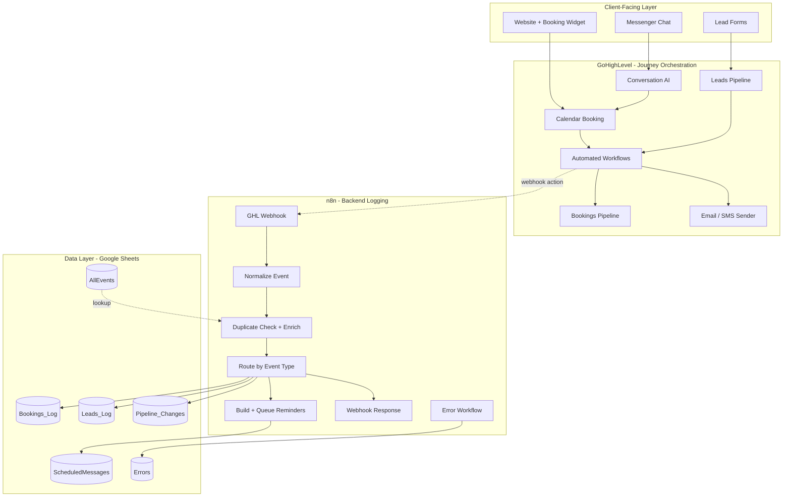
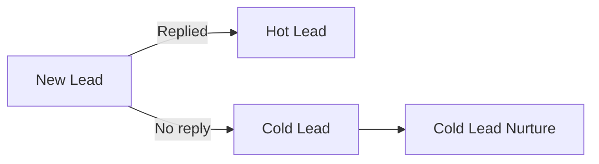
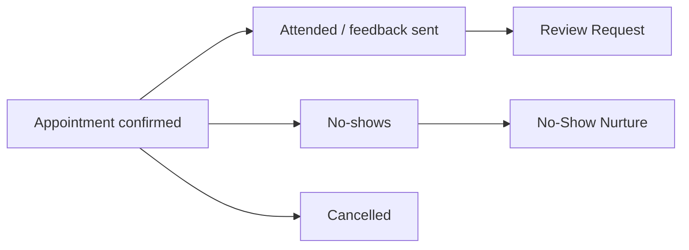
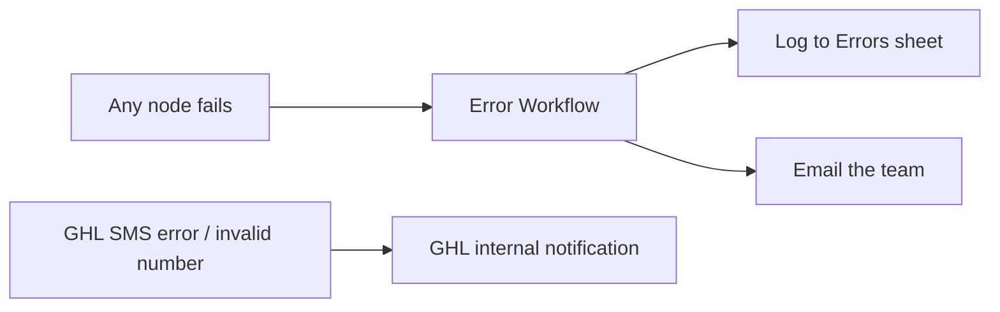

# Architecture — Holistic Wellness Club (GHL + n8n)

Two-layer architecture: **GoHighLevel handles the client journey, n8n handles backend logging and reliability.** The separation lets each tool do what it does best.

Status: built and tested in a GHL staging sub-account (February 2026); GHL workflows are in Draft.

---

## High-level architecture

## Why two layers?

| Need | Owned by | Reason |
|---|---|---|
| Client-facing journeys | GHL | Visual builder, native email/SMS, calendars, forms |
| Pipeline management | GHL | Operators work in a familiar CRM view |
| Custom code/logic | n8n | Full JavaScript in Code nodes |
| Multi-API integration | n8n | Any HTTP/API target, not limited to GHL actions |
| Error monitoring | n8n | Workflow-level error handler with alerting |
| Detailed event logging | n8n | Normalized, de-duplicated, append-only log |

**Pattern:** use GHL for what it does well (client journeys, simple workflows) and n8n for what it does well (custom logic, observability, integration glue).

## GoHighLevel layer

### Pipelines

**Pipeline 1: Wellness Club – Leads**

**Pipeline 2: Holistic Services – Bookings**

### Automated workflows in GHL
- **Appointment Confirmation + Reminders** — confirmation email, 24-hour reminder email, 2-hour reminder email + SMS; monitoring branch for SMS errors and invalid numbers
- **New Lead Nurture** — email + SMS after one day, two-day reply window, intent branching on replies
- **Cold Lead Nurture** — re-engagement for leads who never booked
- **No-Show Nurture** — recovery sequence for missed appointments
- **Send Review Request** — SMS then email, 2 days after an attended visit
- **Cancelled Appointment** — cancellation handling

GHL Conversation AI answers service questions on Messenger and points prospects to the booking widget.

## n8n layer

### Event Logger & Reminder Scheduler (`workflow.json`)

One webhook receives all GHL events:

1. **GHL Webhook** — `POST /ghl-event`, responds through a Respond to Webhook node
2. **Normalize Event** — maps GHL event types to `lead.*`, `opportunity.*`, `appointment.*` and builds a single contact / opportunity / appointment schema, keeping a 1,000-character raw-payload excerpt for debugging
3. **Check Duplicates** — Google Sheets lookup of `event_id` in AllEvents
4. **Enrich & Idempotency** — flags duplicates; adds `day_of_week`, `hour_of_day`, `is_business_hours`, `funnel_position`, `week_iso`
5. **Not Duplicate?** — duplicates go straight to the webhook response
6. **Route by Event Type** — `appointment.created`, `lead.created`, `opportunity.status_changed`, plus a fallback output
7. **Log Appointment / Log Lead / Log Pipeline Change** — append to Bookings_Log, Leads_Log, Pipeline_Changes
8. **Build Reminders → Queue Reminders** — 24-hr, 2-hr, and post-visit touchpoints appended to ScheduledMessages

The build-environment canvas in `screenshots/photo_7` shows the earlier version of this layer: separate appointment and lead webhook branches plus an error trigger. `workflow.json` consolidates them behind one webhook with idempotency and routing.

### Error workflow

Set through the workflow's Error Workflow setting (not included in this export). It catches any failed execution, logs it to the Errors sheet, and emails the team.

### Reporting

The KPIs tab uses summary formulas and pivot tables over the log tabs. Derived fields written at ingest keep those formulas simple.

## Data layer (Google Sheets)

| Sheet | Purpose | Written by |
|---|---|---|
| **AllEvents** | Event-ID index for duplicate detection | Appended by **Record Event ID** when an event is first seen |
| **Bookings_Log** | One row per new appointment | Log Appointment |
| **Leads_Log** | One row per new lead | Log Lead |
| **Pipeline_Changes** | Stage changes and all other event types | Log Pipeline Change |
| **ScheduledMessages** | Planned 24-hr / 2-hr / post-visit touchpoints | Queue Reminders |
| **Errors** | Failed executions with context | Error workflow |
| **KPIs** | Reporting for stakeholders | Sheet formulas |

## Idempotency strategy

GHL retries webhooks on failure. Without idempotency, retries create duplicate log rows.

**Implementation:**
1. Look up the incoming `event_id` in AllEvents
2. If it matches, mark the event `_skip_reason: duplicate_event` and acknowledge it without logging
3. Otherwise record the `event_id` in AllEvents (**Record Event ID**), then enrich, route, and log

**Known gap:** payloads without an `id` receive a generated ID, so retries of those payloads are not caught.

## Error handling

## Performance characteristics

- **Per-event cost:** two to three Google Sheets API calls; JavaScript steps are negligible
- **Duplicate handling:** retries with a known `event_id` are acknowledged, not re-logged
- **Coverage:** the fallback route ensures every event type is logged
- **Production metrics:** none yet; see [PERFORMANCE.md](PERFORMANCE.md)
