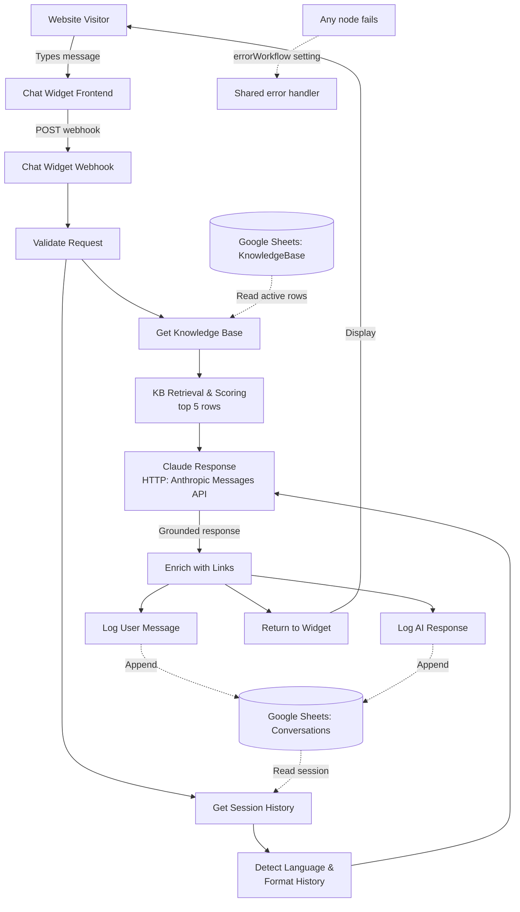
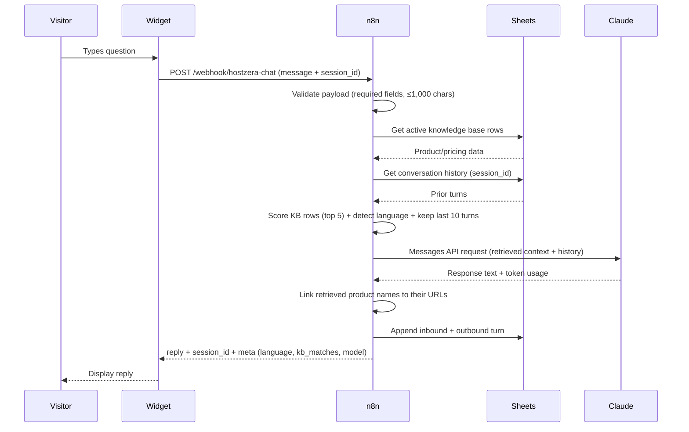

# Architecture — Hostzera AI Chat Widget

Retrieval-grounded AI chat widget. The model is instructed to answer only from verified company data retrieved from Google Sheets, never from its training data, and to escalate when that data does not cover the question. Measured hallucination rate: ~0.5% (see [PERFORMANCE.md](PERFORMANCE.md)).

---

## System diagram



## The retrieval-grounding principle

Most chat widgets hallucinate because they let the LLM answer from its training data. This system constrains it:

**Standard chatbot:**
```
User: "How much does WordPress hosting cost?"
LLM: [Uses training data, possibly outdated or wrong]
Response: "WordPress hosting typically costs $5-15/month..."
```

**Retrieval-grounded (this system):**
```
User: "How much does WordPress hosting cost?"
Step 1: Retrieve from KB → Found row: "WordPress Hosting", "$8/month", "/wordpress"
Step 2: AI receives only this context
Step 3: AI responds: "Our WordPress Hosting is $8/month."
        OR (if not in KB): "Let me connect you with our team for that."
```

**Result:** Prices and plan details come from the knowledge base, not the model. The residual failure modes are a stale KB row (1% in the audit) or the model over-inferring from context (0.5%: one inferred discount, fixed by tightening the prompt). Both are tracked in [PERFORMANCE.md](PERFORMANCE.md).

## Data flow detail



## Why keyword retrieval over Sheets instead of vector RAG (for this use case)

| Approach | Pros | Cons |
|---|---|---|
| **Vector DB RAG** | Scales to large KBs, semantic search | More infrastructure and cost, embedding drift, requires re-indexing |
| **Google Sheets KB + keyword scoring (this)** | Free, editable by non-technical staff, instant updates, deterministic and debuggable | Keyword scoring loses precision beyond ~500 products |

For Hostzera's product catalog (~50 services), Sheets is the right tool. The team updates prices and descriptions directly without engineering involvement.

## Knowledge base structure

| Column | Purpose | Example |
|---|---|---|
| `product` | Searchable product name (exact match doubles the score) | "Business Email Hosting" |
| `description` | Detailed description | "Professional email with 50GB storage..." |
| `price` | Current price (always up-to-date) | "$12/month" |
| `tags` | Additional searchable keywords | "email, business, professional, smtp" |
| `alternate_names` | Synonyms included in scoring | "business mail, company email" |
| `url` | Direct link to product page | "/business-email" |
| `active` | Only rows with `TRUE` are loaded | "TRUE" |

## Multi-language support

The system detects language from the user's message by Unicode range and sets the reply language in the system prompt.

**Detected languages:**
- English (default)
- Arabic (Unicode range detection)
- Russian (Cyrillic detection)
- Chinese (CJK detection)

## Performance characteristics

Summary of [PERFORMANCE.md](PERFORMANCE.md):

- **Response time:** ~1.5 s typical, 3.0 s P95 (webhook in → reply out)
- **Cost per conversation:** ~$0.018 (5–7 turns)
- **Knowledge base size:** Keyword scoring holds precision up to ~500 products
- **Concurrent sessions:** 30 sustained

## Reliability features

1. **Input validation** — Malformed payloads and messages over 1,000 characters are rejected before any API call
2. **Retry on the model call** — The Claude HTTP node retries transient failures (3 attempts, 2 s apart, 15 s timeout)
3. **Polite refusal** — Out-of-scope questions get a hand-off message, not a fabricated answer
4. **Human handoff** — The prompt routes uncovered questions to the Hostzera team
5. **Bounded context** — Only the top 5 KB rows and the last 10 turns are sent, keeping prompts small and cost predictable
6. **Centralized error handling** — Failures go to the [shared error handler](../shared-error-handler) via the `errorWorkflow` setting
