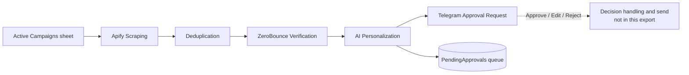
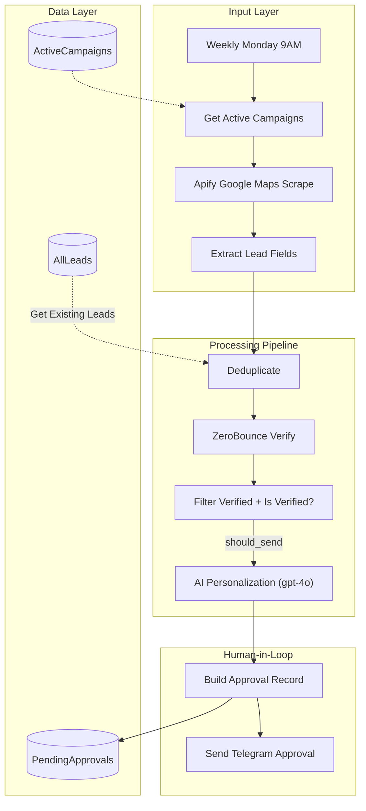
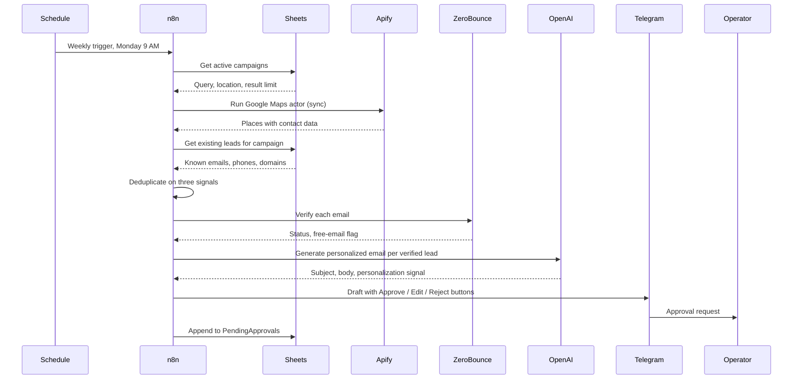

# Architecture — Lead Generation & AI Outreach Engine

Lead generation pipeline with a mandatory human approval gate. Built for marketing agencies running cold outreach campaigns at scale without sacrificing sender reputation.

**Scope of this export:** [`workflow.json`](workflow.json) covers scraping through the approval request. It ends when a draft is posted to Telegram and queued in the `PendingApprovals` sheet; acting on the operator's decision and sending approved emails are not part of this file.

---

## High-level pipeline

## Detailed component view

## Phase-by-phase breakdown

### Phase 1 — Targeted Scraping
- **Trigger:** Schedule, every Monday at 09:00 (`0 9 * * 1`)
- **Tool:** Apify Google Maps actor (`compass~crawler-google-places`, run-sync endpoint, 300 s timeout)
- **Input:** Per-campaign `search_query`, `location` and `max_results` (default 100) from the `ActiveCampaigns` sheet
- **Output:** Business name, email, phone, website, address, city, country, category, rating, review count
- **Filter:** Businesses with no email address are dropped at extraction

### Phase 2 — Multi-Signal Deduplication
- **Inputs:** Newly scraped leads + the campaign's existing records in `AllLeads`
- **Dedup signals:** email (lower-cased), phone (digits only), website domain (`www.` stripped)
- **Why three signals:** Different businesses can share emails (catch-alls), phones can be miscaptured, but domain match is highly reliable
- **Within-batch dedup:** Each accepted lead is added to the lookup sets, so the same business scraped twice in one run is caught
- **Output:** Truly new leads, each with a `lead_id` and `lead_status: new`

### Phase 3 — Email Verification
- **Tool:** ZeroBounce API (10 s timeout, up to 4 attempts, 2 s apart)
- **Cost:** ~$0.007 per verification
- **Why critical:** Sending to invalid emails damages sender reputation; one bad campaign can push a domain into spam folders for months
- **Filter:** Only `valid` or `catch-all` statuses proceed, and free-provider and disposable addresses are excluded

### Phase 4 — AI Personalization
- **Model:** OpenAI `gpt-4o`, temperature 0.7, JSON response format
- **Context provided:** Business name, category, city and country, rating and review count, website
- **Output:** JSON with `subject`, `body` and `personalization_signal` (the detail the model referenced)
- **Prompt constraints:** 80-word body limit, one call to action, pain point first, stock openers banned; the operator is the final check

### Phase 5 — Human Approval (CRITICAL GATE)
- **Tool:** Telegram bot with inline buttons
- **Review options:**
  - ✅ Approve
  - ✏️ Edit
  - ❌ Reject
- **Why required:** AI personalization at scale + cold outreach = high spam risk without a human filter
- **Queue:** Every draft is appended to `PendingApprovals` with `approval_id`, `lead_id`, draft, status `pending_review` and a 48-hour `response_deadline`

## Data flow

## Quality and reliability features

| Feature | Purpose |
|---|---|
| **Three-signal dedup** | Prevents contacting the same business twice within a campaign |
| **Dedup before verification** | No ZeroBounce credits spent on known leads |
| **ZeroBounce verification** | Protects sender reputation |
| **Retry on verification** | ZeroBounce calls retry transient failures (4 attempts, 2 s apart) |
| **Human approval gate** | No bulk-send incidents from AI mistakes |
| **Approval deadline** | Every record carries a 48-hour `response_deadline` so stale drafts are identifiable |
| **Approval audit record** | Draft, personalization signal and IDs persisted per lead |
| **Error monitoring** | Failures go to the [shared error handler](../shared-error-handler) via the `errorWorkflow` setting |

## Performance characteristics

Summary of [PERFORMANCE.md](PERFORMANCE.md):

- **Throughput:** ~150 verified, personalized, approved leads per week per active campaign
- **Verification cost:** ~$1.05 per 150 leads (ZeroBounce)
- **AI cost:** ~$1.50–3.00 per 150 personalized emails (gpt-4o)
- **Approval time:** Typically 4–12 hours from generation to decision (operator dependent)
- **Bounce rate after verification:** <2%
- **Reply rate:** 8–12% on well-targeted lists
