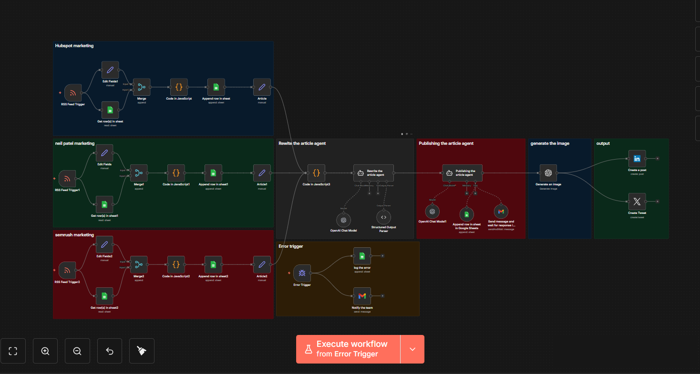

# Permission-First AI Content Pipeline

Automation that turns newly published articles into permission-based LinkedIn post drafts and sends each original author a consent request before anything is shared
(RSS Feeds · AI Content Generation · Author Permission · Audit Logging)

**Status:** Working n8n build. The exported workflow covers discovery → AI rewrite → author permission request; author replies and publishing happen outside this export.

---



> The canvas above is from the original build, which also prototyped approval-gated publishing (wait-for-reply, image generation, LinkedIn/X posting). Those stages are **not** part of the exported [`workflow.json`](workflow.json), which is the reference implementation documented here.

---

## Workflow Architecture

```
Schedule Trigger (every 6 hours)
  → Get active feed URLs (Google Sheets: ActiveFeeds)
    → Read RSS feed
      → Check if already seen (Google Sheets: SeenArticles)
        → Filter new & recent (< 48 hours, title + snippet required)
          → AI rewrite (OpenAI GPT-4o, JSON output) → LinkedIn post draft
            → Compose permission request email (draft included)
              → Has a verified contact? (address published in the feed)
                  yes → Send via Gmail → Log request (pending_response, 7-day deadline)
                  no  → Log request (needs_contact — no email is sent)
                → Mark article as seen (SeenArticles)

Failures → workflow-level Error Workflow setting
```

---

## What This System Does

A permission-first content pipeline for marketing teams: it monitors curated sources, drafts AI-assisted LinkedIn posts that preserve the original facts, and asks each author for consent before anything is shared, with every request logged.

- Pulls the latest articles from a sheet-managed list of RSS feeds on a schedule
- Uses AI to rewrite each article into a LinkedIn-style post draft that credits and links the original
- Emails the original author with the draft and asks for permission to share it — **only at an address the publisher lists in the feed; addresses are never guessed**
- Logs every request with its draft, the facts preserved, status, and response deadline
- Publishes nothing on its own: the PermissionRequests sheet is the hand-off point for replies and publishing

---

## How It Works

1. **Fetch new articles**
   - Reads active feed URLs from the ActiveFeeds sheet every 6 hours
   - Skips articles whose URL is already in SeenArticles
   - Keeps only articles published in the last 48 hours that have a title and content snippet

2. **Generate the draft**
   - GPT-4o rewrites the article into one LinkedIn-style post (max 300 words, hook-first)
   - The prompt forbids new facts and impersonating the author, and requires a source line crediting the original
   - Output is structured JSON: the post, the list of facts preserved, and rewrite notes

3. **Ask the author for permission**
   - Uses the author's contact address only if the publisher includes it in the feed (the RSS `<author>` field, e.g. `jane@site.com (Jane Doe)`)
   - **No address is ever inferred or guessed** — unsolicited email to guessed personal addresses is a GDPR / PDPL risk and damages sender reputation
   - With a verified address: sends a short email via Gmail with the full draft, asking whether the author is comfortable with it being shared, and logs the request as `pending_response` with a 7-day deadline
   - Without one: logs the request as `needs_contact` so a person can find the right channel; nothing is sent

4. **Track**
   - Every request is appended to PermissionRequests; every processed article is marked in SeenArticles
   - Replies arrive in the Gmail inbox and are actioned from the PermissionRequests sheet

5. **Errors**
   - The workflow's Error Workflow setting routes failed executions to a dedicated error handler

---

## Stack

| Layer | Tools |
|---|---|
| **Orchestration** | n8n (self-hosted on VPS) |
| **AI** | OpenAI GPT-4o (rewriting, JSON output mode) |
| **Data** | Google Sheets (ActiveFeeds, SeenArticles, PermissionRequests) |
| **Sources** | RSS feeds |
| **Email** | Gmail (author outreach) |

---

## Impact

- Turns a curated feed list into **fact-preserving, credited LinkedIn drafts** without manual writing
- Keeps outreach **ethical and permission-based**: no post is shared without first asking the author
- Gives teams an **auditable record** of what was drafted, who was asked, and what is still pending

---

## Notes

- Demonstrates marketing automation built around consent, logging, and clear hand-off points
- Fully configurable: feeds are managed in a sheet, and the rewrite prompt and email template live in single nodes
- Known limits are documented in [PERFORMANCE.md](PERFORMANCE.md)
