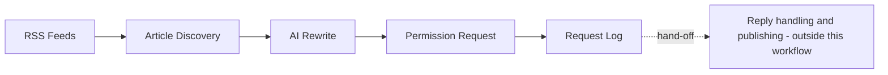
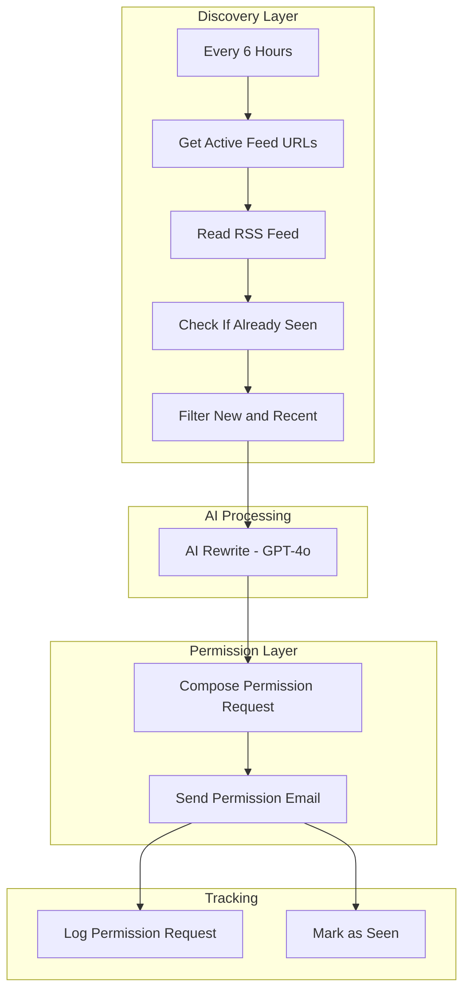
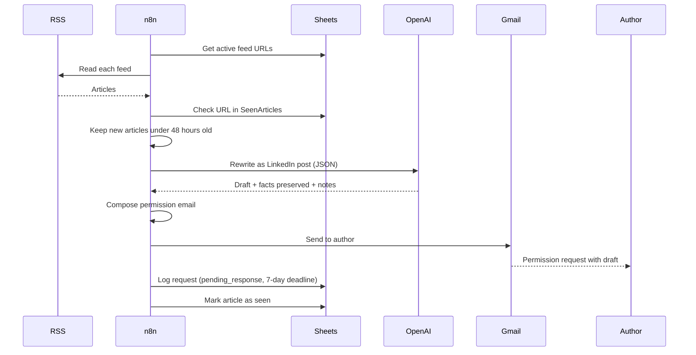
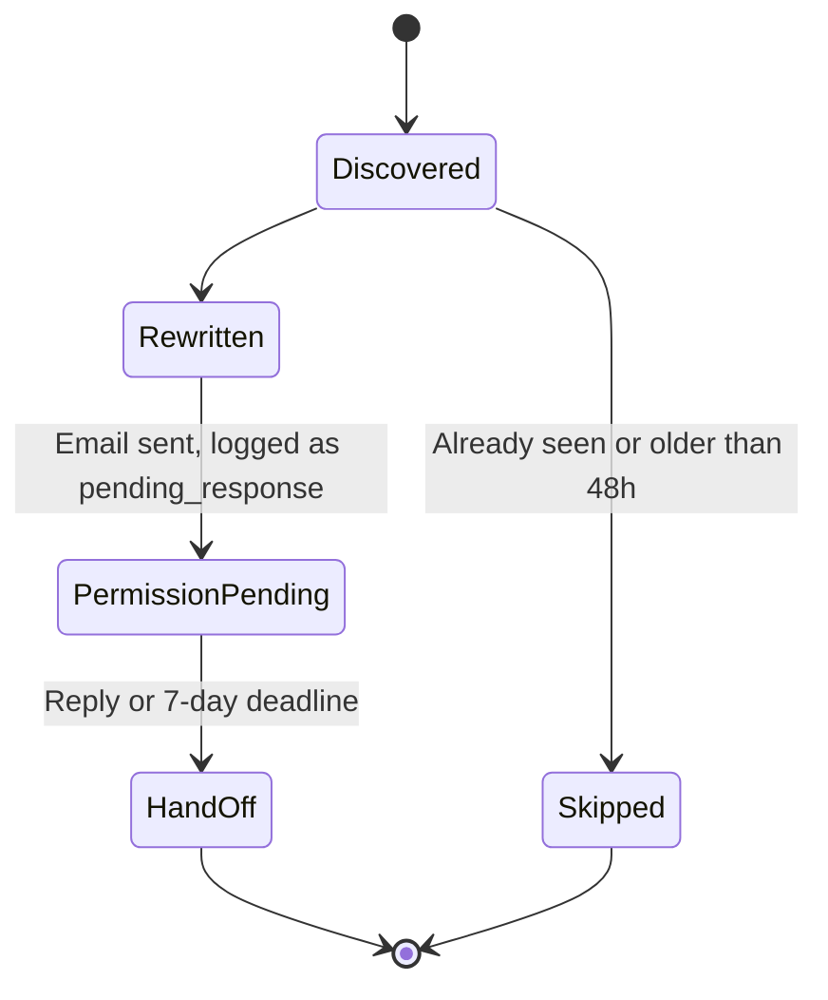

# Architecture — Marketing Content Pipeline

Ethical content marketing automation. **Permission-based, not theft-based.** The pipeline drafts a post and asks the original author for consent; it never publishes on its own.

---

## High-level flow

## Detailed component diagram

Every box maps to a node in [`workflow.json`](workflow.json).

## Sequence: from RSS to permission request

## Ethical foundation

This pipeline was designed to be different from "content scraping" tools that republish others' work without permission.

**Standard content automation:**
- Scrapes articles
- Rewrites with AI
- Publishes as if original
- Hopes the original author doesn't notice

**This pipeline:**
- Discovers articles
- Rewrites with AI, preserving the original facts
- **Asks the author for permission, with the full draft attached**
- Always credits and links the original
- Publishes nothing automatically

**Result:** content relationships built on consent, and a clear record of every request.

## Permission request lifecycle

States set by this workflow, and where the hand-off happens:

`HandOff` is outside this workflow: replies land in Gmail and are actioned from the PermissionRequests sheet.

## Guardrails

Built into the exported workflow:

1. **Dedup before spend** — SeenArticles lookup runs before the AI call, so no article is rewritten or pitched twice
2. **Freshness and completeness** — articles must be under 48 hours old and have a title and snippet
3. **Constrained rewrite** — the prompt forbids new facts and impersonation and requires a source line
4. **Structured output** — JSON response mode; the composer parses `linkedin_post` and `facts_preserved`
5. **Consent before sharing** — the only outbound action is the permission email

## Tracking layer

| Sheet | Tracked data |
|---|---|
| **ActiveFeeds** | Feed URLs and `active` flag (input) |
| **SeenArticles** | URL, title, `discovered_at` |
| **PermissionRequests** | Request ID, article ID / URL / title / author, inferred author email, subject, body, proposed post, facts preserved, `status: pending_response`, `sent_at`, `response_deadline` |

## Performance characteristics

- **Cadence:** every 6 hours, 48-hour freshness window
- **Per-article cost:** ~$0.05-0.10 in GPT-4o spend; ~30 seconds per rewrite
- **Outbound actions:** one permission email per new article; nothing is published automatically
- **Details and limits:** see [PERFORMANCE.md](PERFORMANCE.md)
