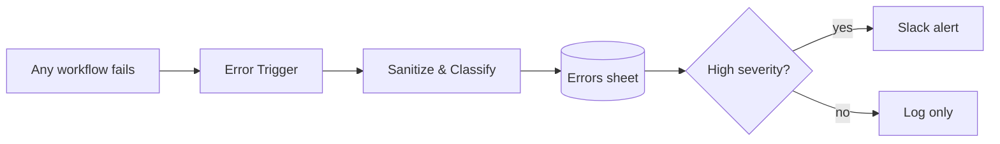

# Shared Error Handler — Sanitized Logging & Alerting

**Stack:** n8n · JavaScript · Google Sheets · Slack
**Role:** Observability layer shared by every workflow in this portfolio

Every workflow in this repository sets `settings.errorWorkflow` to this handler. When any execution fails, the failure is sanitized, classified, logged and — if it matters — escalated to a human. Nothing fails silently.

## How it works

| Step | Node | What it does |
|---|---|---|
| 1 | **Error Trigger** | Fires on any failed execution of a workflow that points here |
| 2 | **Sanitize & Classify** | Redacts secrets and PII, truncates oversized payloads, assigns severity |
| 3 | **Log Error** | Appends one row per failure to the `Errors` sheet — a complete audit trail |
| 4 | **High Severity?** | Customer-facing or auth failures are escalated; transient issues are log-only |
| 5 | **Alert Team (Slack)** | Posts workflow, failed node, sanitized message and execution link |

## Two layers of resilience

1. **Node-level retries absorb transient failures.** External API nodes across the portfolio use `retryOnFail` with 3 tries, 2 seconds apart — rate limits and brief network errors recover without anyone noticing.
2. **This handler catches what retries cannot.** Only failures that survive the retries reach the Error Trigger, so every alert is worth reading.

## Sanitization

Applied before anything is written or sent:

- **By key:** any field whose name matches `api_key`, `authorization`, `bearer`, `password`, `secret`, `token`, `cookie`, `session` or `signature` becomes `[REDACTED]`
- **By pattern:** bearer tokens, `sk-` style API keys, email addresses and phone numbers inside free text are masked
- **By size:** strings are capped at 2,000 characters, arrays at 50 items, nesting at 8 levels

Verified against a synthetic failure containing a bearer token, an API key, an email and a phone number — all four were masked in the logged row and the alert.

## Severity rules

| Severity | Matches | Action |
|---|---|---|
| **High** | Webhooks, outbound messaging (WhatsApp, Messenger, Telegram), calendar/booking, payments, 401/403 | Log + Slack alert |
| **Medium** | Everything else | Log only |
| **Low** | Rate limits (429), timeouts, connection resets | Log only (usually already retried) |

## Setup

1. Import `workflow.json` into n8n.
2. Set environment variables `ERRORS_LOG_SHEET_ID` and `SLACK_ERROR_CHANNEL`.
3. Replace the `REPLACE_*_CREDENTIAL_ID` placeholders with your Google Sheets and Slack credentials.
4. In each workflow, set **Settings → Error workflow** to this workflow (replaces `REPLACE_WITH_ERROR_WORKFLOW_ID`).
